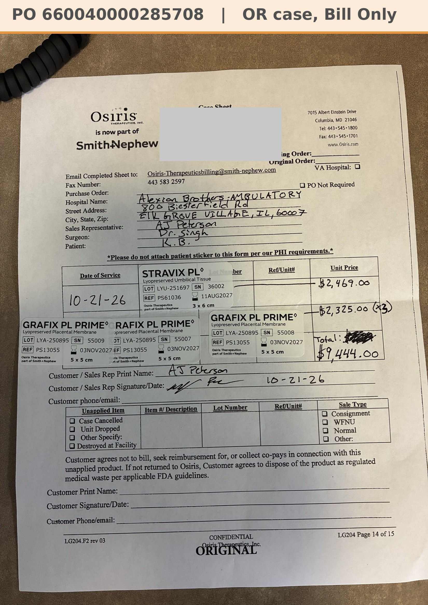

# Case sheet: K.B. 10/21/26

[⬅ Back to tracker](../README.md) · [PDF](./kb-1021.pdf)

**OR case** (not a recurring graft patient) · Bill Only · one PO for all four pieces

**Lot/SN**
```
LYU-251697_36002
```
```
LYA-250895_55007
```
```
LYA-250895_55008
```
```
LYA-250895_55009
```
**PO**
```
660040000285708
```

| Field | Value |
| --- | --- |
| Date of service | 10/21/26 |
| Patient | K.B. |
| Account | Alexian Brothers - Ambulatory (Acct #186035) |
| Surgeon | Dr. Singh |
| Product | Stravix PL 3 x 6 × 1 + Grafix PL Prime 5 x 5 × 3 |
| REF | PS61036 (Stravix), PS13055 (Grafix) |
| Units | LYU-251697_36002 (exp 8/11/27); LYA-250895_55007, LYA-250895_55008, LYA-250895_55009 (exp 11/3/27) |
| Price | Stravix $2,469.00 + Grafix 3 × $2,325.00 = $9,444.00 total |
| Status | Ready to submit (PO 660040000285708, 10/21, bill only) |
| Note | Case sheet photo from the Patients app (Dr. Singh OR 10/21). The hospital patient label is covered on this copy. From Alexian Ambulatory's own consignment (186035), so no transfer |


