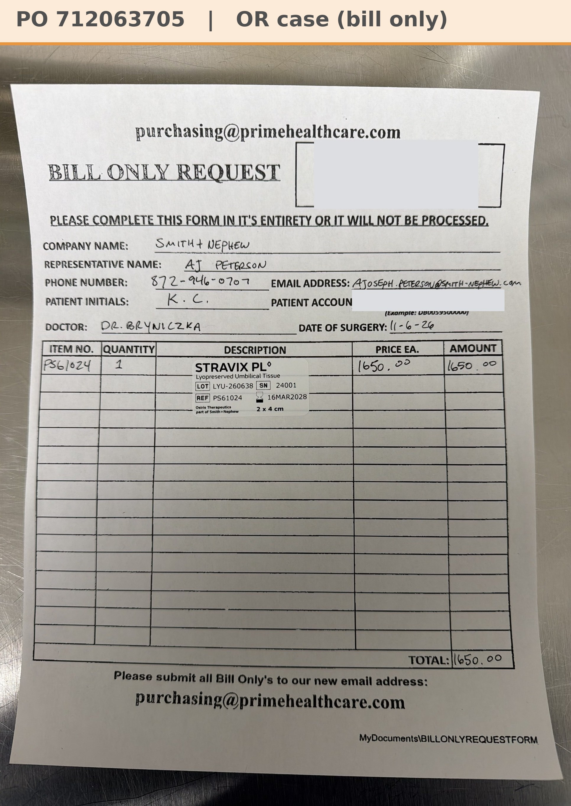

# Case sheet: K.C. 11/6/26

[⬅ Back to tracker](../README.md) · [PDF](./kc-1106.pdf)

**OR case** (not a recurring graft patient) · Bill Only

**Lot/SN**
```
LYU-260638_24001
```
**PO**
```
712063705
```

| Field | Value |
| --- | --- |
| Date of service | 11/6/26 (add-on case) |
| Patient | K.C. |
| Account | Saint Joseph Hospital - Elgin (Acct #296620) |
| Surgeon | Dr. Greg Bryniczka |
| Product | Stravix PL 2 x 4 cm |
| REF | PS61024 |
| Lot | LYU-260638 |
| SN | 24001 |
| Price | $1,650 |
| Expiry | 3/16/28 |
| Status | PO 712063705 (Prime Healthcare bill only; proc date 11/6, Dr. Gregory Bryniczka, PS61024 2x4 $1,650.00), matched by patient ID and date of service. Ready to submit |
| Note | AJ's Bill Only Request photo from Chi West 11/6. Patient label and hospital account number covered on this copy |


