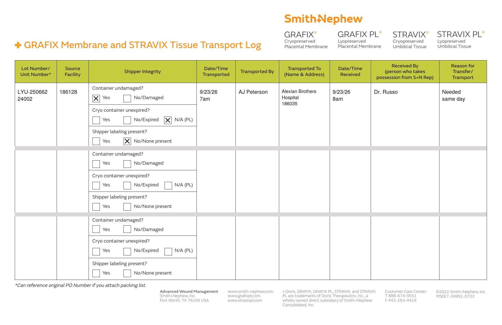

# Case sheet: L.S. 9/23/26

[⬅ Back to tracker](../README.md) · [Transfer log](./ls-0923-transport-log.pdf)

**OR case** · submitted in September

**Lot/SN**
```
LYU-250662_24002
```
**PO**
```
660040000283496
```

| Field | Value |
| --- | --- |
| Date of service | 9/23/26 |
| Patient | L.S. |
| Account | Alexian Brothers - Ambulatory (OR) · 186035 |
| Surgeon | Dr. Russo |
| Product | Stravix PL 2x4 cm |
| REF | PS61024 |
| Unit | LYU-250662_24002 (exp 4/1/27) |
| Price | $1,553.10 |
| Status | In SFDC (PO 660040000283496) |
| Note | Case sheet image not on file here (submitted in September) |


## Transfer log

Skokie Hospital (186128) → Alexian Brothers (186035). The unit was still on Skokie Hospital consignment in the BIOT Chicago district consignment report (10/11), so it was transferred to the account it was used at (needed same day, day used 7am to 8am).

[Transfer log PDF](./ls-0923-transport-log.pdf)



Your handwritten log for this unit (IMG_6895) shows lot LYU-250622; the system lot is **LYU-250662**, which is what the typed log uses.
