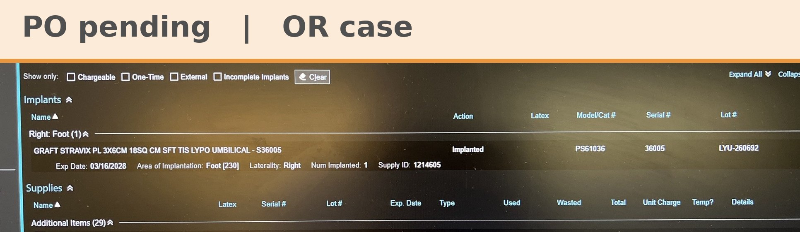

# Case sheet: Dr. Luetkehans 11/18/26

[⬅ Back to tracker](../README.md) · [PDF](./luetkehans-1118.pdf)

**OR case** (not a recurring graft patient) · Good Sam OR shelf · Bill Only

**Lot/SN**
```
LYU-260692_36005
```
**PO**
```
pending
```

| Field | Value |
| --- | --- |
| Date of service | 11/18/26 |
| Patient | no initials (AJ 11/20) |
| Account | Advocate Good Samaritan Hospital (OR) |
| Surgeon | Dr. Luetkehans |
| Product | Stravix PL 3 x 6 cm |
| REF | PS61036 |
| Lot | LYU-260692 |
| SN | 36005 |
| Price | $2,655.50 |
| Expiry | 3/16/28 |
| Status | Waiting on the Owens & Minor PO |
| Note | Typed case sheet from AJ's photo of the hospital implant screen (right foot, 1 implanted), sent 11/20. There are no initials for this case, so the Patient line is left blank (AJ 11/20). The screen photo is below the case sheet |



