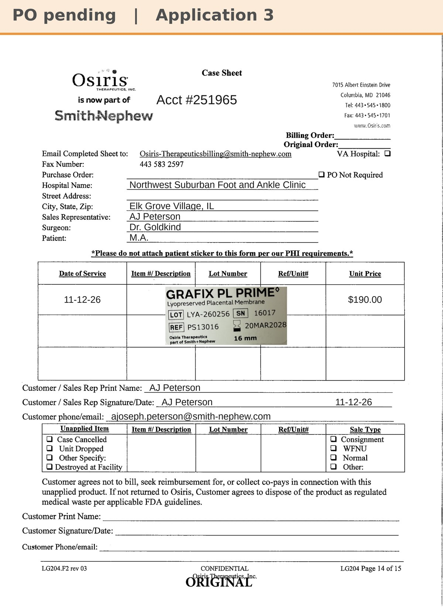

# Case sheet: M.A. 11/12/26

[⬅ Back to tracker](../README.md) · [PDF](./ma-1112.pdf)

**Application #3**

**Lot/SN**
```
LYA-260256_16017
```
**PO**
```
pending
```

| Field | Value |
| --- | --- |
| Date of service | 11/12/26 |
| Patient | M.A. |
| Account | Northwest Suburban Foot and Ankle Clinic (Elk Grove) |
| Surgeon | Dr. Goldkind |
| Product | Grafix PL Prime 16mm |
| REF | PS13016 |
| Lot | LYA-260256 |
| SN | 16017 |
| Price | $190.00 |
| Expiry | 3/20/28 |
| Application | #3 (9:45 AM) |
| Status | Waiting on PO |
| Note | Made from the sticker on AJ's application-sheet photo uploaded in Chi West 11/12 with the Grafted tap |


