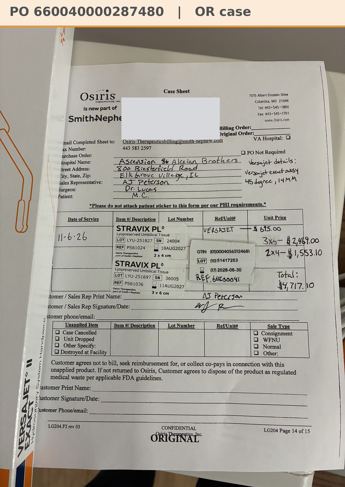

# Case sheet: M.C. 11/6/26

[⬅ Back to tracker](../README.md) · [PDF](./mc-1106.pdf)

**OR case** (not a recurring graft patient) · Bill Only · Stravix only (AJ 11/11: VERSAJET goes on its own case sheet)

**Lot/SN**
```
LYU-251827_24004
```
```
LYU-251697_36005
```
**PO**
```
pending
```

| Field | Value |
| --- | --- |
| Date of service | 11/6/26 (9:45 AM) |
| Patient | M.C. |
| Account | Alexian Brothers - Ambulatory (Acct #186035) |
| Surgeon | Dr. Lucas |
| Product | Stravix PL 2 x 4 (PS61024) + Stravix PL 3 x 6 (PS61036) |
| Lot/SN | LYU-251827_24004 (exp 8/18/27) · LYU-251697_36005 (exp 8/11/27) |
| Price | Stravix 2x4 $1,553.10 · Stravix 3x6 $2,469.00 · **Total $4,022.10** |
| Status | Waiting on the Alexian Ambulatory PO (bill only; FIN 3004469 on the hospital label for matching) |
| Note | Both Stravix units came off the Alexian Ambulatory shelf (its own consignment, so no transfer). Same patient as the M.C. weekly OASIS patient (A11 10/30). The hospital patient label is covered on this copy. AJ 11/11: the VERSAJET handpiece ($695) is off this case; it gets its own case sheet, and this photo (which still lists it) will be replaced by the Stravix-only sheet |


