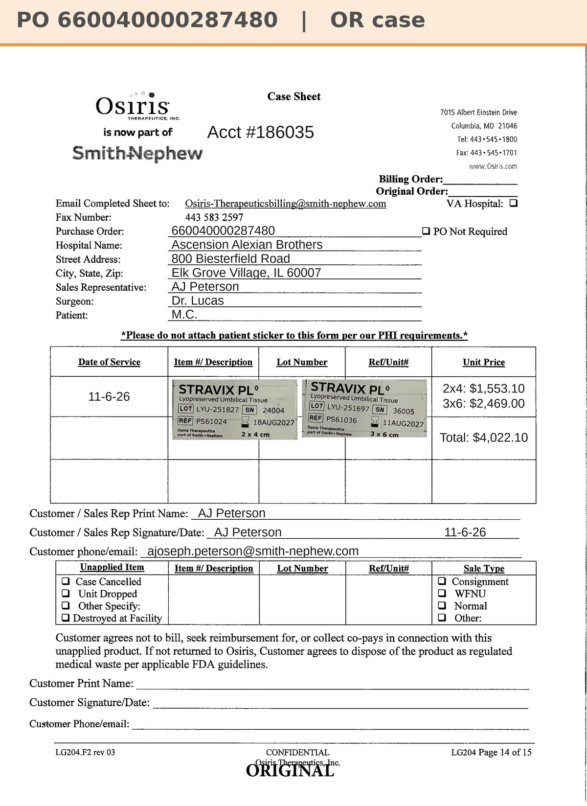
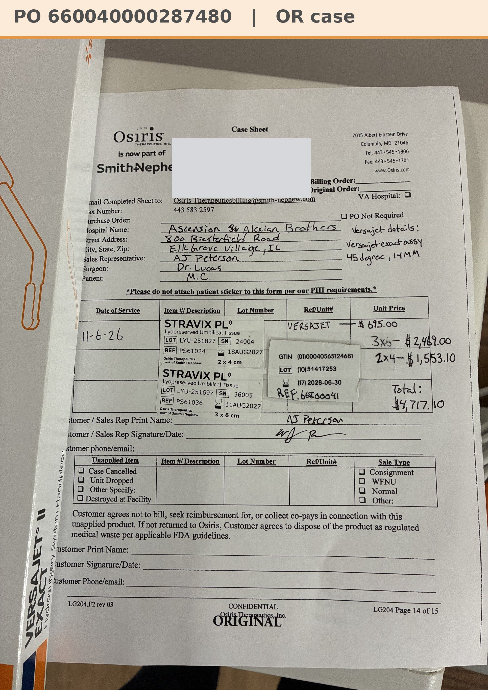
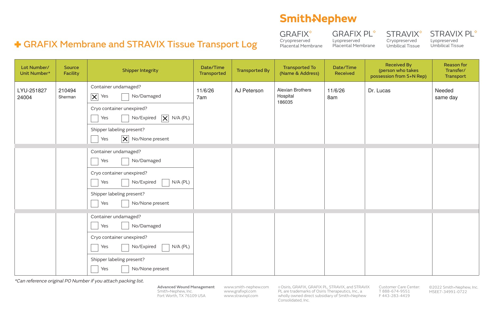

# Case sheet: M.C. 11/6/26

[⬅ Back to tracker](../README.md) · [PDF](./mc-1106.pdf) · [Transfer log](./mc-1106-transport-log.pdf)

**OR case** (not a recurring graft patient) · Bill Only · Stravix only (AJ 11/11: VERSAJET goes on its own case sheet)

**Lot/SN**
```
LYU-251827_24004
```
```
LYU-251697_36005
```
**PO**
```
660040000287480
```

| Field | Value |
| --- | --- |
| Date of service | 11/6/26 (9:45 AM) |
| Patient | M.C. |
| Account | Alexian Brothers - Ambulatory (Acct #186035) |
| Surgeon | Dr. Lucas |
| Product | Stravix PL 2 x 4 (PS61024) + Stravix PL 3 x 6 (PS61036) |
| Lot/SN | LYU-251827_24004 (exp 8/18/27) · LYU-251697_36005 (exp 8/11/27) |
| Price | Stravix 2x4 $1,553.10 · Stravix 3x6 $2,469.00 · **Total $4,022.10** |
| Status | Submitted 11/24: bill-only PO 660040000287480 (11/11/26). S+N asked for a transfer log on the 2x4 before processing it (11/25) |
| Note | Stravix-only case sheet made 11/24 at AJ's request, from the two Stravix stickers on his 11/6 case sheet photo, with the correct prices (2x4 $1,553.10 + 3x6 $2,469.00 = $4,022.10; the photo's handwritten total of $4,717.10 included the VERSAJET handpiece). Both Stravix units came off the Alexian Ambulatory shelf; the 3x6 is on its own consignment, the 2x4 was still on Advocate Sherman's (transfer log below, 11/25). Same patient as the M.C. weekly OASIS patient (A11 10/30). The VERSAJET handpiece has its own line on the tracker and is not on this sheet; AJ's original photo, which shows its lot sticker, is kept below (hospital label covered) |





## Transfer log

Advocate Sherman Hospital (210494) → Alexian Brothers (186035). While processing the PO, S+N found Stravix 2x4 LYU-251827_24004 still on Advocate Sherman's consignment (it is in the BIOT Chicago district consignment report of 10/11 there too), so it was transferred to the account it was used at (needed same day, 11/6 7am to 8am, received by Dr. Lucas). Typed 11/25.

[Transfer log PDF](./mc-1106-transport-log.pdf)


