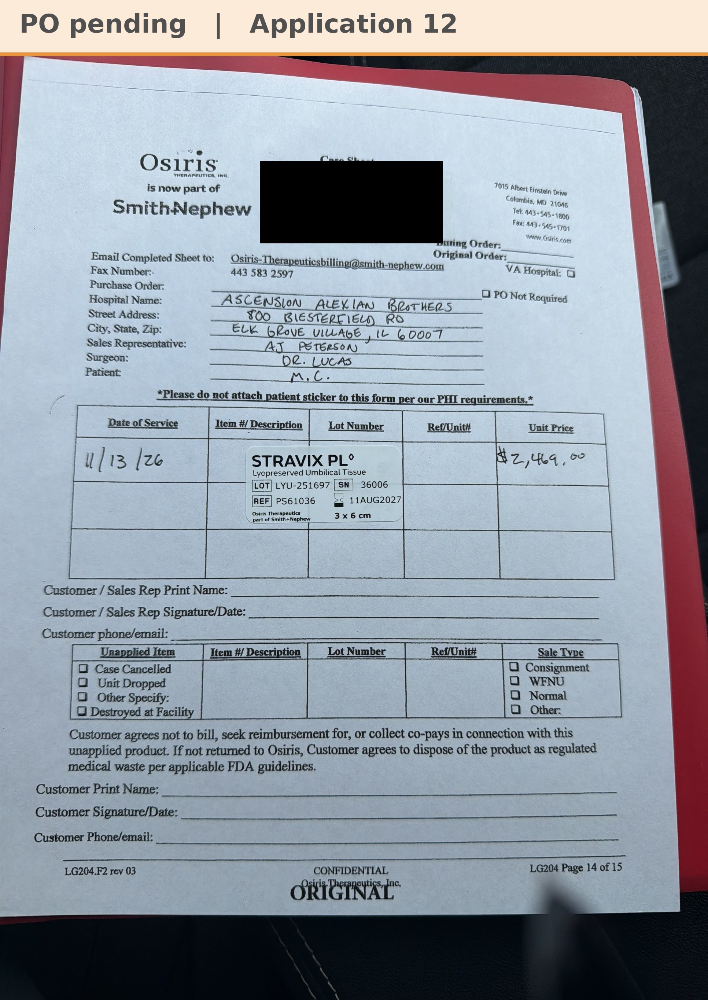

# Case sheet: M.C. 11/13/26

[⬅ Back to tracker](../README.md) · [PDF](./mc-1113.pdf)

**Application 12** · Stravix follow up at Alexian Ambulatory · Bill Only

**Lot/SN**
```
LYU-251697_36006
```
**PO**
```
pending
```

| Field | Value |
| --- | --- |
| Date of service | 11/13/26 (9:45 AM) |
| Patient | M.C. |
| Account | Alexian Brothers - Ambulatory (Acct #186035) |
| Surgeon | Dr. Lucas |
| Product | Stravix PL 3 x 6 (PS61036) |
| Lot/SN | LYU-251697_36006 (exp 8/11/27) |
| Price | $2,469.00 |
| Status | Waiting on the bill-only PO |
| Note | AJ's case sheet photo, uploaded in Chi West 11/13. The unit came off the Alexian Ambulatory shelf (its own consignment, so no transfer). The hospital patient label is covered on this copy. AJ switched M.C. from OASIS to Stravix 3x6 in Chi West 11/13 |


