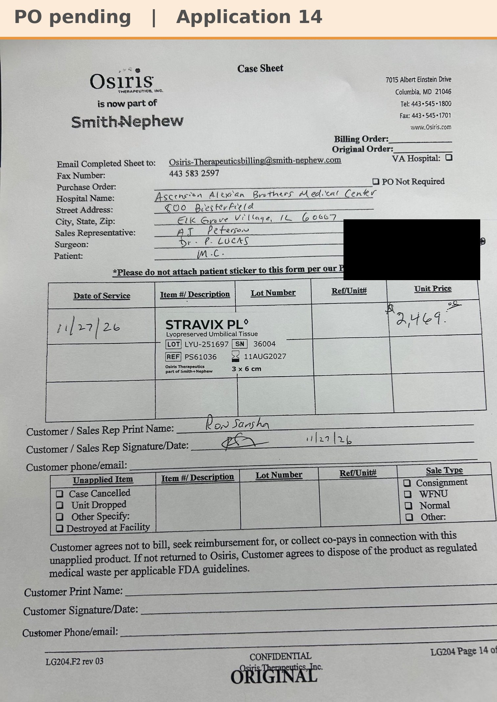

# Case sheet: M.C. 11/27/26

[⬅ Back to tracker](../README.md) · [PDF](./mc-1127.pdf)

**Application 14** · Stravix follow up at Alexian Ambulatory · Bill Only

**Lot/SN**
```
LYU-251697_36004
```
**PO**
```
pending
```

| Field | Value |
| --- | --- |
| Date of service | 11/27/26 (9:45 AM) |
| Patient | M.C. |
| Account | Alexian Brothers - Ambulatory (Acct #186035) |
| Surgeon | Dr. Lucas |
| Product | Stravix PL 3 x 6 (PS61036) |
| Lot/SN | LYU-251697_36004 (exp 8/11/27) |
| Price | $2,469.00 |
| Status | Waiting on the bill-only PO |
| Note | AJ's case sheet photo, sent 11/27; Ron Sangha covered and signed it. The unit came off the Alexian Ambulatory shelf (its own consignment, so no transfer). The hospital patient label is covered on this copy |


