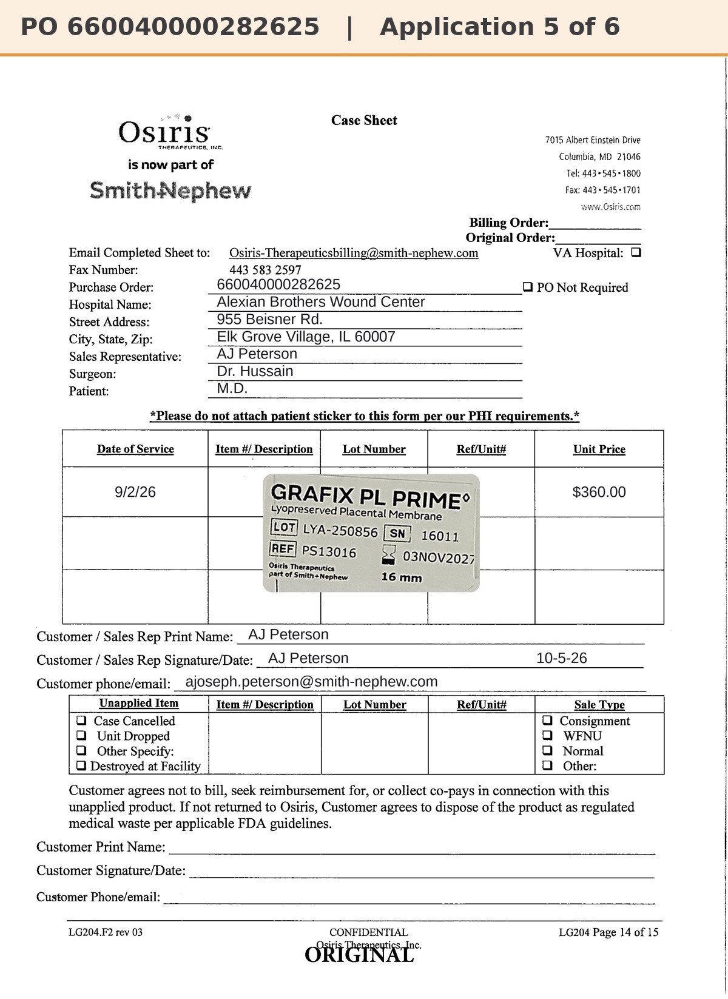

# Case sheet: M.D. 9/2/26

[⬅ Back to tracker](../README.md) · [PDF](./md-0902.pdf) · [Application log page](./md-0902-log.jpg)

**Application #5** of 6 to date (Alexian application log)

**Lot/SN**
```
LYA-250856_16011
```
**PO**
```
660040000282625
```
**Alexian ID**
```
0002680445
```

| Field | Value |
| --- | --- |
| Date of service | 9/2/26 |
| Patient | M.D. |
| Account | Alexian Brothers Wound Center |
| Surgeon | Dr. Hussain |
| Product | Grafix PL Prime 16mm disc |
| REF | PS13016 |
| Lot | LYA-250856 |
| SN | 16011 |
| Price | $360.00 |
| Expiry | 11/3/27 |
| Application | #5 of 6 to date |
| Status | Submitted 10/5 |
| Note | Case sheet created 10/5 from the 300 DPI template; the sticker image comes from Graft #5 on the Alexian application log. PO ...282625 received 9/14. Not in SFDC yet |


