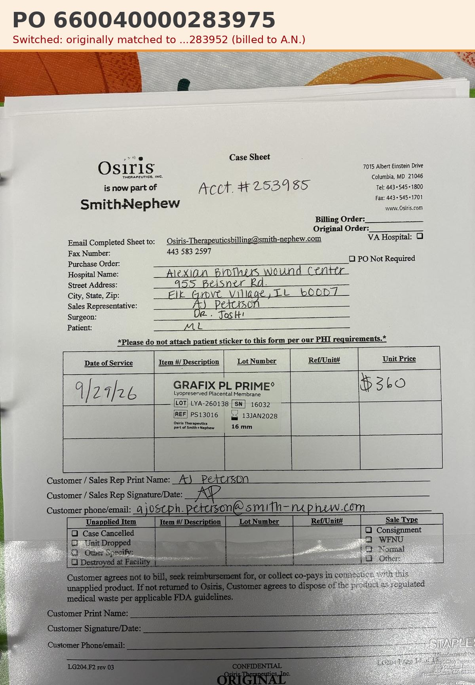

# Case sheet: M.L. 9/29/26

[⬅ Back to tracker](../README.md) · [PDF](./ml-0929.pdf)

**Application #1** of 1 to date (per the 10/2 patient list)

**Lot/SN**
```
LYA-260138_16032
```
**PO**
```
660040000283975
```
**Alexian ID**
```
0003052747
```

| Field | Value |
| --- | --- |
| Date of service | 9/29/26 |
| Patient | M.L. |
| Account | Alexian Brothers Wound Center |
| Surgeon | Dr. Joshi |
| Product | Grafix PL Prime 16mm disc |
| REF | PS13016 |
| Lot | LYA-260138 |
| SN | 16032 |
| Price | $360.00 |
| Expiry | 1/13/28 |
| Application | #1 of 1 to date |
| Status | In SFDC: inv 0985813797 (transaction 10/9) on PO 660040000283975 |
| Note | App #1 of 1 (10/2 list). PO SWITCHED: submitted 10/8 on ...283975 (A.N.'s PO, Patient ID 0002817866) because A.N. was billed on ...283952 (M.L.'s PO). Not in SFDC yet |


