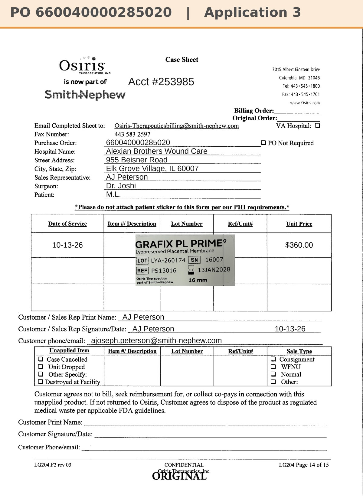

# Case sheet: M.L. 10/13/26

[⬅ Back to tracker](../README.md) · [PDF](./ml-1013.pdf)

**Application #3**

**Lot/SN**
```
LYA-260174_16007
```
**PO**
```
660040000285020
```
**Alexian ID**
```
0003052747
```

| Field | Value |
| --- | --- |
| Date of service | 10/13/26 (12:00 PM) |
| Patient | M.L. |
| Account | Alexian Brothers Wound Center (Acct #253985) |
| Surgeon | Dr. Joshi |
| Product | Grafix PL Prime 16mm disc |
| REF | PS13016 |
| Lot | LYA-260174 |
| SN | 16007 |
| Price | $360.00 |
| Expiry | 1/13/28 |
| Application | #3 |
| Status | Ready to submit (PO 660040000285020, 10/13) |
| Note | Case sheet made 10/14 from the sticker on the WCC application log (graft #3, 10/13 12:00, photo in the Patients app). From the Alexian WCC shelf (10/5 shipment) |


