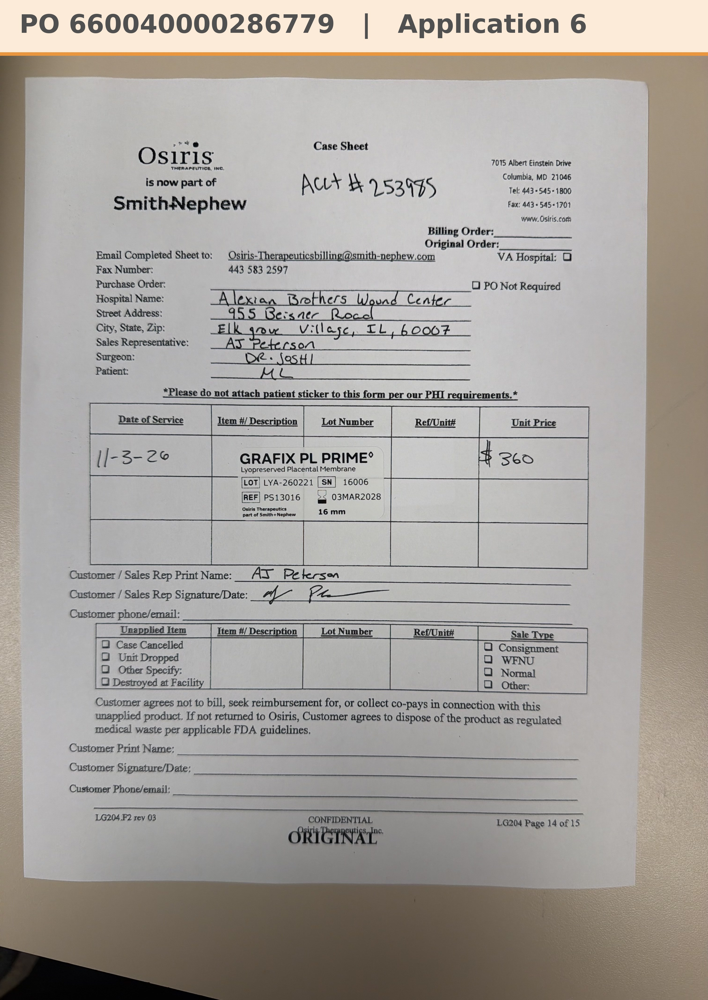

# Case sheet: M.L. 11/3/26

[⬅ Back to tracker](../README.md) · [PDF](./ml-1103.pdf)

**Application #6**

**Lot/SN**
```
LYA-260221_16006
```
**PO**
```
660040000286779
```
**Alexian ID**
```
0003052747
```

| Field | Value |
| --- | --- |
| Date of service | 11/3/26 (2:15 PM) |
| Patient | M.L. |
| Account | Alexian Brothers Wound Center (Acct #253985) |
| Surgeon | Dr. Joshi |
| Product | Grafix PL Prime 16mm disc |
| REF | PS13016 |
| Lot | LYA-260221 |
| SN | 16006 |
| Price | $360.00 |
| Expiry | 3/3/28 |
| Application | #6 |
| Status | Ready to submit (PO 660040000286779, bill only, dated 11/3, received 11/5) |
| Note | Case sheet photo uploaded in the Patients app 11/3 (filed 11/4; A5 was 10/27, [case sheet](./ml-1027.md)). From the Alexian WCC shelf. PO 660040000286779 (bill only, by patient ID) came in 11/5 and is in the banner |


