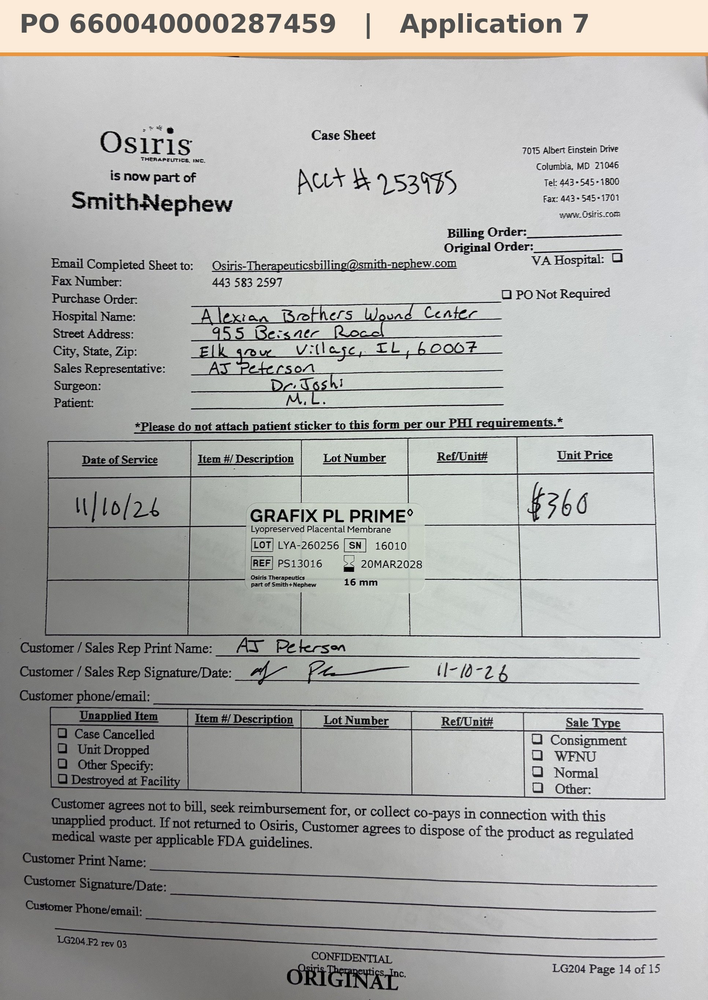

# Case sheet: M.L. 11/10/26

[⬅ Back to tracker](../README.md) · [PDF](./ml-1110.pdf)

**Application #7**

**Lot/SN**
```
LYA-260256_16010
```
**PO**
```
660040000287459
```
**Alexian ID**
```
0003052747
```

| Field | Value |
| --- | --- |
| Date of service | 11/10/26 (1:00 PM) |
| Patient | M.L. |
| Account | Alexian Brothers Wound Center (Acct #253985) |
| Surgeon | Dr. Joshi |
| Product | Grafix PL Prime 16mm disc |
| REF | PS13016 |
| Lot | LYA-260256 |
| SN | 16010 |
| Price | $360 |
| Expiry | 3/20/28 |
| Application | #7 |
| Status | Ready to submit: bill-only PO 660040000287459 (11/11/26) received |
| Note | AJ's case sheet photo from Chi West 11/10, with the Grafted tap. From the Alexian WCC shelf. One application left before the Alexian WCC cap of 8. |


