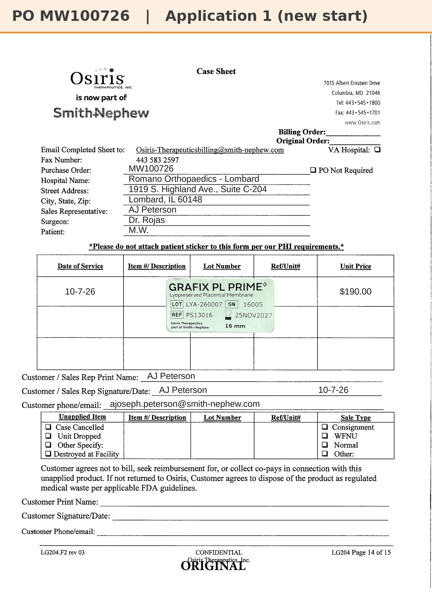
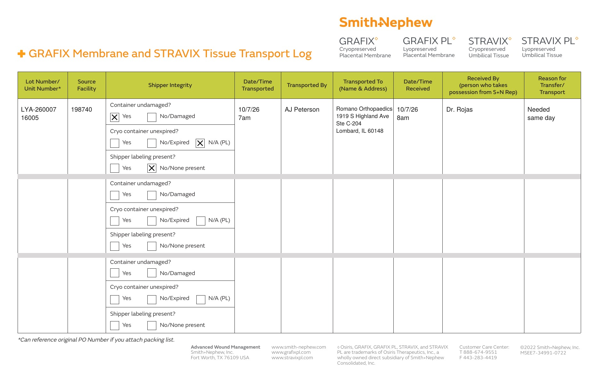

# Case sheet: M.W. 10/7/26

[⬅ Back to tracker](../README.md) · [PDF](./mw-1007.pdf) · [Transfer log](./mw-1007-transport-log.pdf)

**Application #1** (new start)

**Lot/SN**
```
LYA-260007_16005
```
**PO**
```
MW100726
```

| Field | Value |
| --- | --- |
| Date of service | 10/7/26 |
| Patient | M.W. |
| Account | Romano Orthopaedics - Lombard (1919 S. Highland Ave., Suite C-204, Lombard, IL 60148) |
| Surgeon | Dr. Rojas |
| Product | Grafix PL Prime 16mm disc |
| REF | PS13016 |
| Lot | LYA-260007 |
| SN | 16005 |
| Price | $190.00 ($95/cm², 16mm = 2 cm²) |
| Expiry | 11/25/27 |
| Application | #1 |
| Status | Ready to submit (one-off PO MW100726; future orders go on sale-order POs) |



## Transfer log

UChicago Medicine AdventHealth La Grange (198740) → Romano Orthopaedics, Lombard (acct # not on file). The unit was still on UChicago Medicine AdventHealth La Grange consignment in the BIOT Chicago district consignment report (10/11), so it was transferred to the account it was used at (needed same day, day used 7am to 8am).

[Transfer log PDF](./mw-1007-transport-log.pdf)


