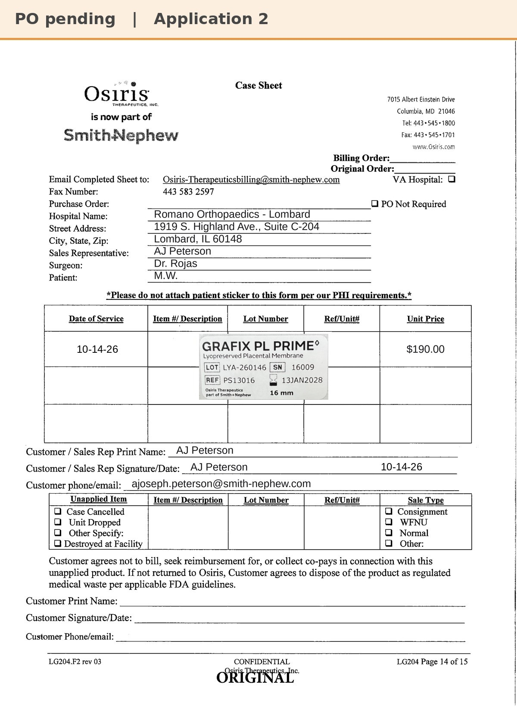
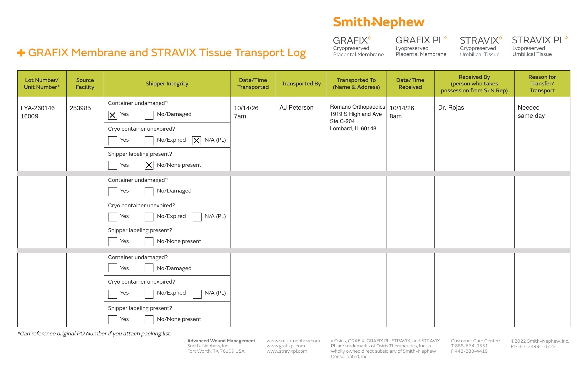

# Case sheet: M.W. 10/14/26

[⬅ Back to tracker](../README.md) · [PDF](./mw-1014.pdf) · [Transfer log](./mw-1014-transport-log.pdf)

**Application #2**

**Lot/SN**
```
LYA-260146_16009
```
**PO**
```
pending (sale order)
```

| Field | Value |
| --- | --- |
| Date of service | 10/14/26 |
| Patient | M.W. |
| Account | Romano Orthopaedics - Lombard (1919 S. Highland Ave., Suite C-204, Lombard, IL 60148) |
| Surgeon | Dr. Rojas |
| Product | Grafix PL Prime 16mm disc |
| REF | PS13016 |
| Lot | LYA-260146 |
| SN | 16009 |
| Price | $190.00 ($95/cm², 16mm = 2 cm²) |
| Expiry | 1/13/28 |
| Application | #2 |
| Status | Waiting on the sale-order PO |
| Note | Case sheet made 10/14 from the sticker photo uploaded in the Patients app. The PO line and banner get updated when the PO arrives |



## Transfer log

Alexian WCC shelf (253985) → Romano Orthopaedics, Lombard (acct # not on file). Per AJ 10/14 this unit was a transfer from Alexian WCC, so it was moved to the account it was used at (needed same day, 10/14 7am to 8am, received by Dr. Rojas).

[Transfer log PDF](./mw-1014-transport-log.pdf)


