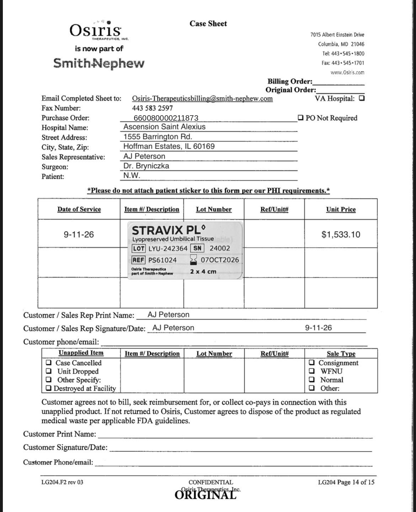
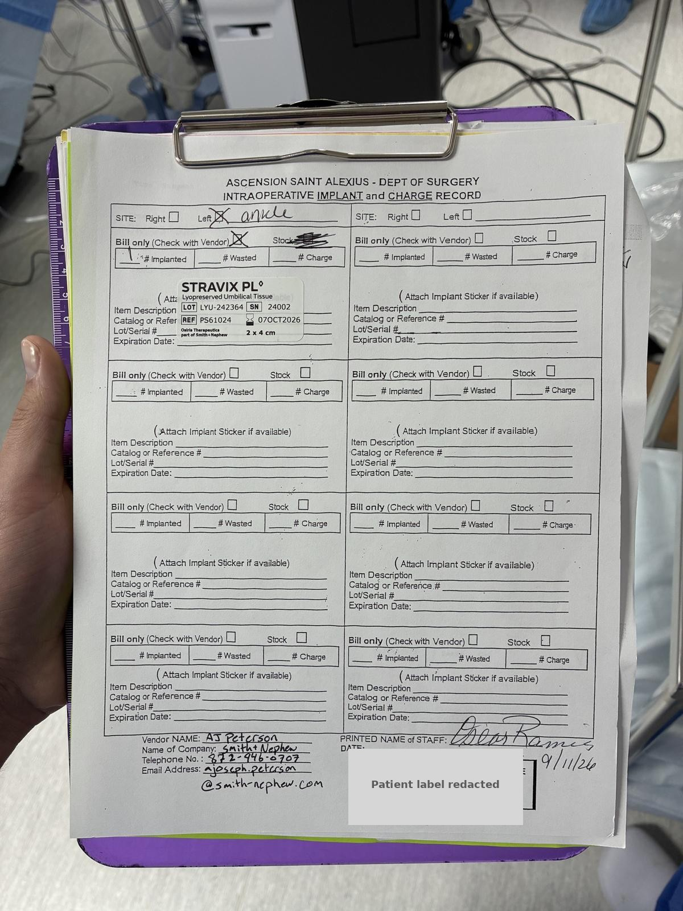

# Case sheet: N.W. 9/11/26

[⬅ Back to tracker](../README.md) · [PDF](./nw-0911.pdf)

**Lot/SN**
```
LYU-242364_24002
```
**PO**
```
none yet
```

| Field | Value |
| --- | --- |
| Date of service | 9/11/26 |
| Patient | N.W. |
| Account | Ascension Saint Alexius |
| Surgeon | Dr. Bryniczka |
| Product | Stravix PL 2 x 4 |
| REF | PS61024 |
| Lot | LYU-242364 |
| SN | 24002 |
| Price | $1,553.10 |
| Expiry | 10/7/26 |
| Status | Not submitted |
| Note | Bill only; L ankle. Price corrected to $1,553.10 per case sheet |



### Hospital implant record (patient label redacted)


