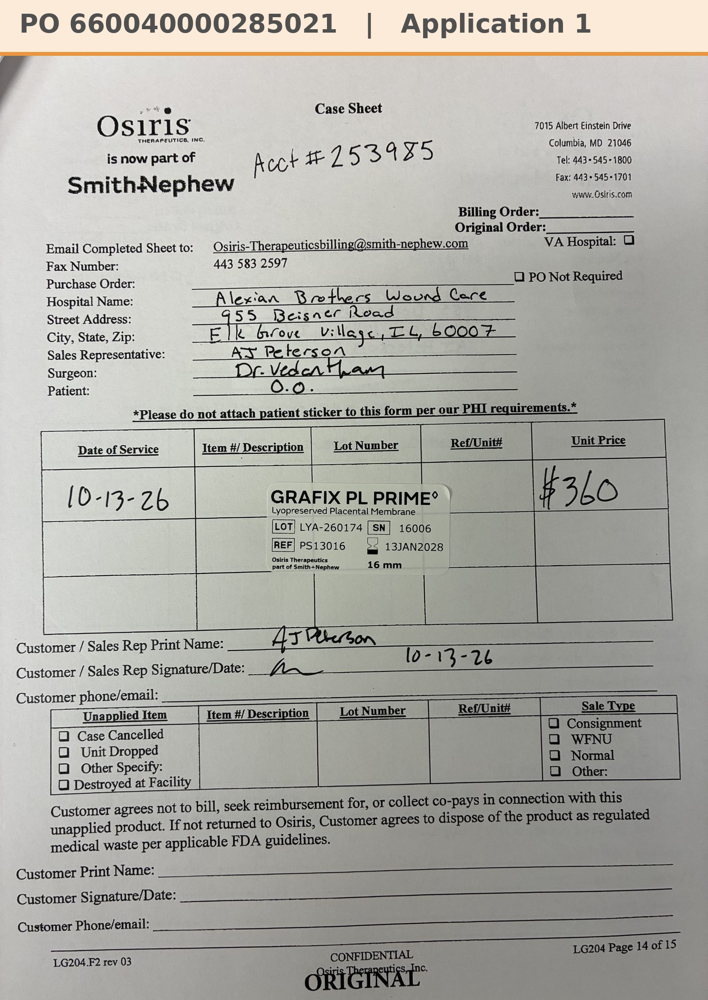

# Case sheet: O.O. 10/13/26

[⬅ Back to tracker](../README.md) · [PDF](./oo-1013.pdf)

**Application #1** (first application)

**Lot/SN**
```
LYA-260174_16006
```
**PO**
```
660040000285021
```
**Alexian ID**
```
0003052679
```

| Field | Value |
| --- | --- |
| Date of service | 10/13/26 |
| Patient | O.O. |
| Account | Alexian Brothers Wound Center (Acct #253985) |
| Surgeon | Dr. Vedantham |
| Product | Grafix PL Prime 16mm disc |
| REF | PS13016 |
| Lot | LYA-260174 |
| SN | 16006 |
| Price | $360.00 |
| Expiry | 1/13/28 |
| Application | #1 |
| Status | Ready to submit (PO 660040000285021, 10/13) |
| Note | Case sheet photo uploaded in the Patients app 10/13 |


