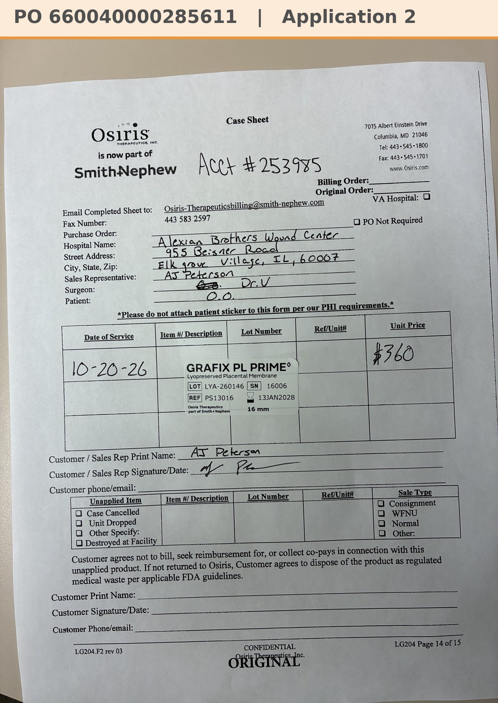

# Case sheet: O.O. 10/20/26

[⬅ Back to tracker](../README.md) · [PDF](./oo-1020.pdf)

**Application #2**

**Lot/SN**
```
LYA-260146_16006
```
**PO**
```
660040000285611
```
**Alexian ID**
```
0003052679
```

| Field | Value |
| --- | --- |
| Date of service | 10/20/26 (12:50 PM) |
| Patient | O.O. |
| Account | Alexian Brothers Wound Center (Acct #253985) |
| Surgeon | Dr. Vedantham ("Dr. V" on the sheet) |
| Product | Grafix PL Prime 16mm disc |
| REF | PS13016 |
| Lot | LYA-260146 |
| SN | 16006 |
| Price | $360.00 |
| Expiry | 1/13/28 |
| Application | #2 |
| Status | Ready to submit (PO 660040000285611, 10/20) |
| Note | Case sheet photo sent 10/27. From the Alexian WCC shelf (10/5 shipment) |


