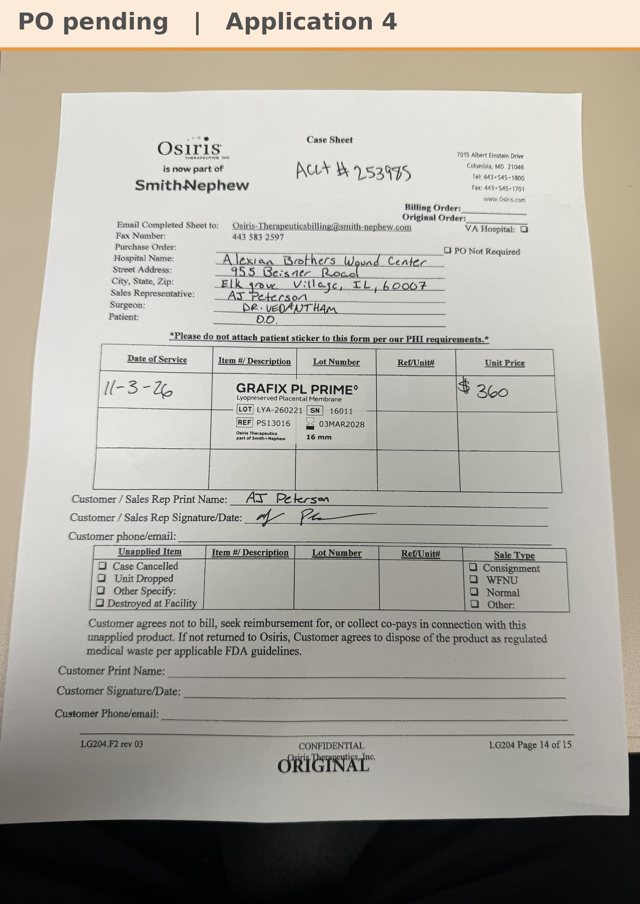

# Case sheet: O.O. 11/3/26

[⬅ Back to tracker](../README.md) · [PDF](./oo-1103.pdf)

**Application #4**

**Lot/SN**
```
LYA-260221_16011
```
**PO**
```
pending
```
**Alexian ID**
```
0003052679
```

| Field | Value |
| --- | --- |
| Date of service | 11/3/26 (12:55 PM) |
| Patient | O.O. |
| Account | Alexian Brothers Wound Center (Acct #253985) |
| Surgeon | Dr. Vedantham |
| Product | Grafix PL Prime 16mm disc |
| REF | PS13016 |
| Lot | LYA-260221 |
| SN | 16011 |
| Price | $360.00 |
| Expiry | 3/3/28 |
| Application | #4 |
| Status | Waiting on the PO (bill only, by patient ID) |
| Note | Case sheet photo sent 11/3 (also uploaded in the Patients app). From the Alexian WCC shelf. The banner gets the PO when it arrives |


