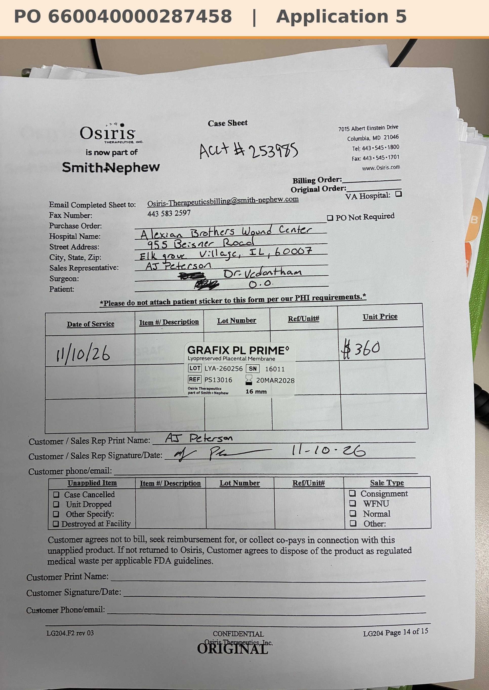

# Case sheet: O.O. 11/10/26

[⬅ Back to tracker](../README.md) · [PDF](./oo-1110.pdf)

**Application #5**

**Lot/SN**
```
LYA-260256_16011
```
**PO**
```
660040000287458
```
**Alexian ID**
```
0003052679
```

| Field | Value |
| --- | --- |
| Date of service | 11/10/26 (12:55 PM) |
| Patient | O.O. |
| Account | Alexian Brothers Wound Center (Acct #253985) |
| Surgeon | Dr. Vedantham |
| Product | Grafix PL Prime 16mm disc |
| REF | PS13016 |
| Lot | LYA-260256 |
| SN | 16011 |
| Price | $360 |
| Expiry | 3/20/28 |
| Application | #5 |
| Status | Ready to submit: bill-only PO 660040000287458 (11/11/26) received |
| Note | AJ's case sheet photo from Chi West 11/10, with the Grafted tap. From the Alexian WCC shelf. |


