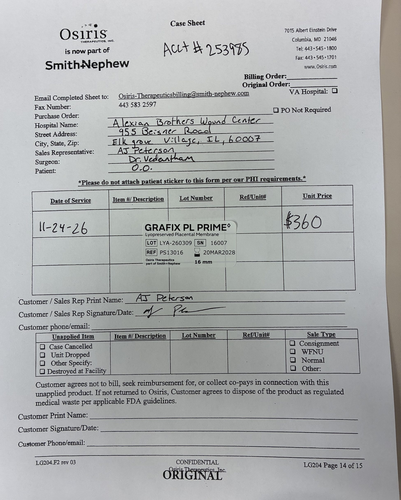

# Case sheet: O.O. 11/24/26

[⬅ Back to tracker](../README.md) · [PDF](./oo-1124.pdf)

**Application #6**

**Lot/SN**
```
LYA-260309_16007
```
**Alexian ID**
```
0003052679
```

| Field | Value |
| --- | --- |
| Date of service | 11/24/26 (12:50 PM) |
| Patient | O.O. |
| Account | Alexian Brothers Wound Center (Acct #253985) |
| Surgeon | Dr. Vedantham |
| Product | Grafix PL Prime 16mm disc |
| REF | PS13016 |
| Lot | LYA-260309 |
| SN | 16007 |
| Price | $360 |
| Expiry | 3/20/28 |
| Application | #6 |
| Status | Waiting on the bill-only PO |
| Note | AJ's case sheet photo from Chi West 11/24 (with the Grafted tap). From the Alexian WCC shelf. |


