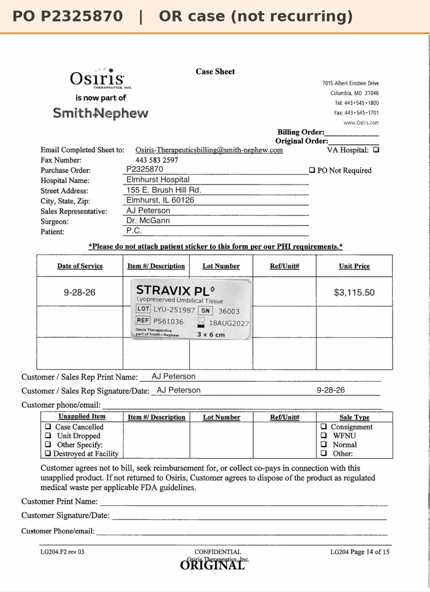

# Case sheet: P.C. 9/28/26

[⬅ Back to tracker](../README.md) · [PDF](./pc-0928.pdf)

**Lot/SN**
```
LYU-251987_36003
```
**PO**
```
P2325870
```

| Field | Value |
| --- | --- |
| Date of service | 9/28/26 |
| Patient | P.C. |
| Account | Elmhurst Hospital |
| Surgeon | Dr. McGann |
| Product | Stravix PL 3 x 6 |
| REF | PS61036 |
| Lot | LYU-251987 |
| SN | 36003 |
| Price | $3,115.50 |
| Expiry | 8/18/27 |
| Status | Ready to submit (PO P2325870 received 10/6) |
| Note | OR case 9/28 at Elmhurst. PO P2325870 received 10/6 and written on the case sheet. Follow-up 10/7 at Romano Orthopedics (Lombard) |


