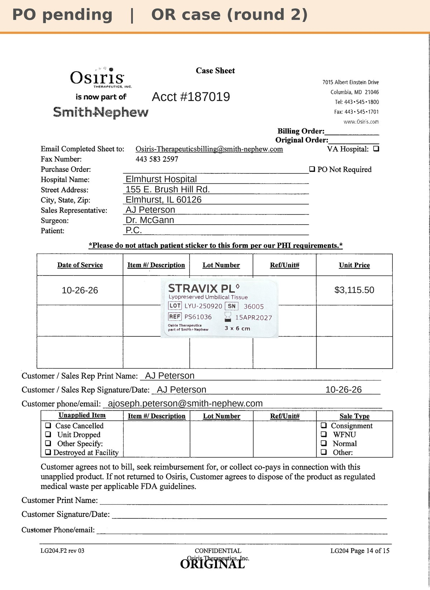

# Case sheet: P.C. 10/26/26

[⬅ Back to tracker](../README.md) · [PDF](./pc-1026.pdf)

**OR case, round 2** · P.C.'s second Stravix (separate case; round 1 was 9/28, [case sheet](./pc-0928.md))

**Lot/SN**
```
LYU-250920_36005
```
**PO**
```
pending
```

| Field | Value |
| --- | --- |
| Date of service | 10/26/26 (7:30 AM) |
| Patient | P.C. |
| Account | Elmhurst Hospital (Acct #187019) |
| Surgeon | Dr. McGann |
| Product | Stravix PL 3 x 6 |
| REF | PS61036 |
| Lot | LYU-250920 |
| SN | 36005 |
| Price | $3,115.50 |
| Expiry | 4/15/27 |
| Status | Waiting on the PO |
| Note | Case sheet made 10/27 from the sticker photo in the Patients app. From Elmhurst's own consignment (187019), so no transfer log this time. The PO line and banner get updated when the PO arrives. Follow-ups at Dr. McGann's Lombard office (Romano Orthopedics) |


