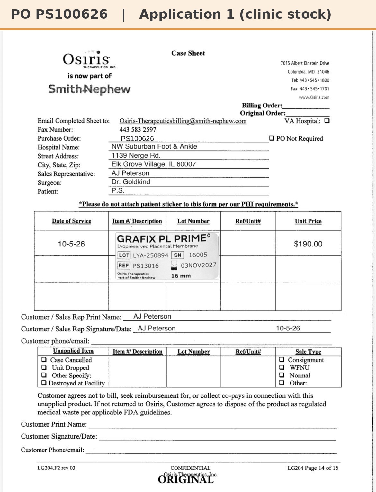

# Case sheet: P.S. 10/5/26

[⬅ Back to tracker](../README.md) · [PDF](./ps-1005.pdf)

**Lot/SN**
```
LYA-250894_16005
```
**PO**
```
PS100626
```

| Field | Value |
| --- | --- |
| Date of service | 10/5/26 |
| Patient | P.S. |
| Account | Northwest Suburban Foot and Ankle Clinic (Elk Grove) |
| Surgeon | Dr. Goldkind |
| Product | Grafix PL Prime 16mm disc |
| REF | PS13016 |
| Lot | LYA-250894 |
| SN | 16005 |
| Price | $190.00 on the case sheet; not an October sale (bought 8/22/26) |
| Expiry | 11/3/27 |
| Application | #1 |
| Status | Clinic stock (PO PS100626, bought 8/22/26), nothing to submit |
| Note | NWSFA bought this 16mm 8/22/26 on PO PS100626. Weekly 16mm orders start 10/12 |


