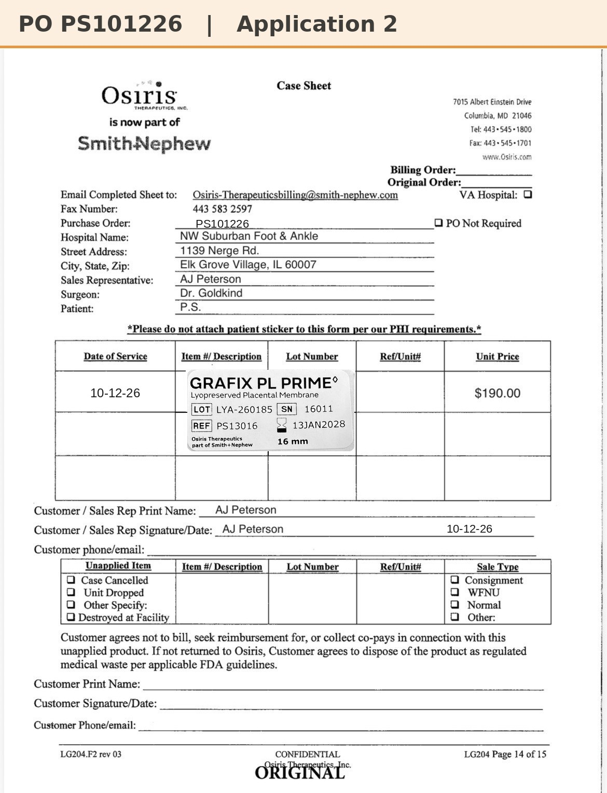

# Case sheet: P.S. 10/12/26

[⬅ Back to tracker](../README.md) · [PDF](./ps-1012.pdf)

**Application #2**

**Lot/SN**
```
LYA-260185_16011
```
**PO**
```
PS101226
```

| Field | Value |
| --- | --- |
| Date of service | 10/12/26 (8:45 AM) |
| Patient | P.S. |
| Account | Northwest Suburban Foot and Ankle Clinic (Elk Grove) |
| Surgeon | Dr. Goldkind |
| Product | Grafix PL Prime 16mm disc |
| REF | PS13016 |
| Lot | LYA-260185 |
| SN | 16011 |
| Price | $190.00 |
| Expiry | 1/13/28 |
| Application | #2 |
| Status | In SFDC (sale order submitted 10/6 on PO PS101226; SFDC serial …16011 matches) |
| Note | Case sheet made from the sticker photo uploaded in the Patients app 10/12. A3 on Mon 10/19 is ordered on PO PS101926 |


