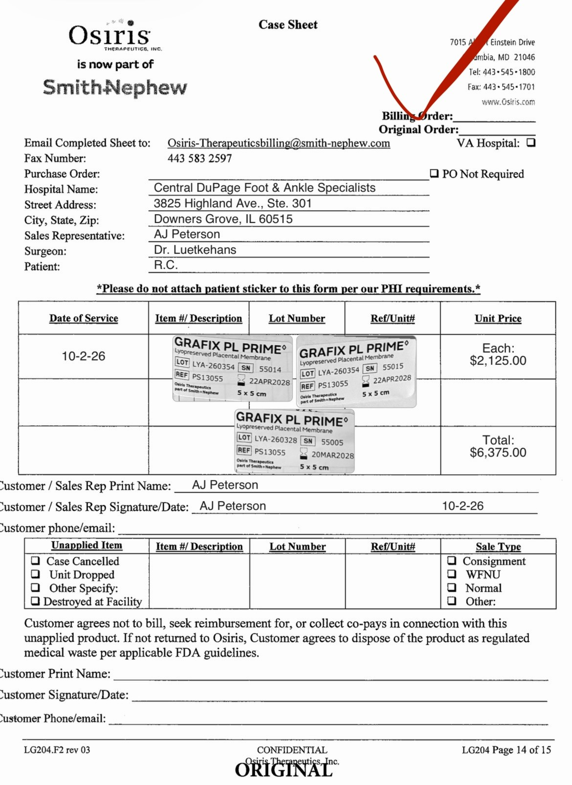

# Case sheet: R.C. 10/2/26

[⬅ Back to tracker](../README.md) · [PDF](./rc-1002.pdf)

**Application #1**

**Lot/SN**
```
LYA-260354_55014
```
```
LYA-260354_55015
```
```
LYA-260328_55005
```
**PO**
```
RC100226
```

| Field | Value |
| --- | --- |
| Date of service | 10/2/26 |
| Patient | R.C. |
| Account | Central DuPage Foot & Ankle Specialists (Downers Grove) |
| Surgeon | Dr. Luetkehans |
| Product | Grafix PL Prime 5x5 cm × 3 |
| REF | PS13055 |
| Units | LYA-260354_55014 (exp 4/22/28), LYA-260354_55015 (exp 4/22/28), LYA-260328_55005 (exp 3/20/28) |
| Price | $2,125.00 each, $6,375.00 total |
| Status | Submitted (PO RC100226), not in SFDC yet |
| Note | 4 were ordered for the 10/2 visit; 3 used |


