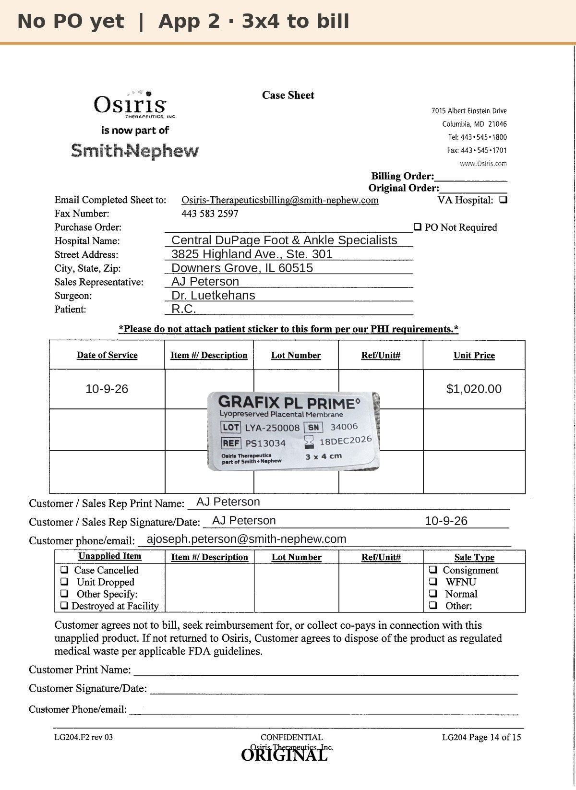
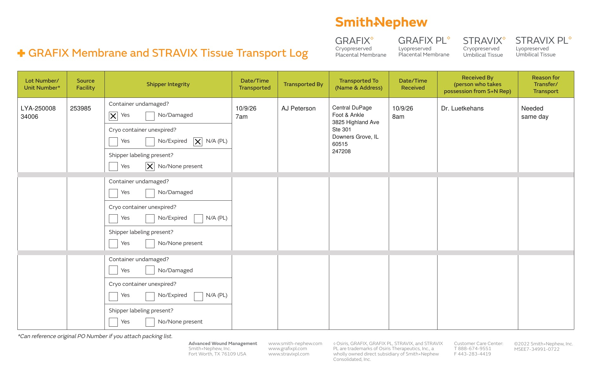

# Case sheet: R.C. 10/9/26 (3x4)

[⬅ Back to tracker](../README.md) · [PDF](./rc-1009-3x4.pdf) · [5x5 sheet](./rc-1009.md) · [Transfer log](./rc-1009-transport-log.pdf)

**Application #2** · the 3x4 needs to be billed to Central DuPage

**Lot/SN**
```
LYA-250008_34006
```
**PO**
```
none yet
```

| Field | Value |
| --- | --- |
| Date of service | 10/9/26 |
| Patient | R.C. |
| Account | Central DuPage Foot & Ankle Specialists (Downers Grove) |
| Surgeon | Dr. Luetkehans |
| Product | Grafix PL Prime 3x4 cm |
| REF | PS13034 |
| Lot | LYA-250008 |
| SN | 34006 |
| Price | $1,020.00 |
| Expiry | 12/18/26 |
| Status | Waiting on the PO |
| Note | Transferred from the Alexian WCC consignment shelf (acct 253985) to Central DuPage. Transport log filled 10/9: [PDF](./rc-1009-transport-log.pdf) |



**Transport log** (Alexian WCC → Central DuPage)


