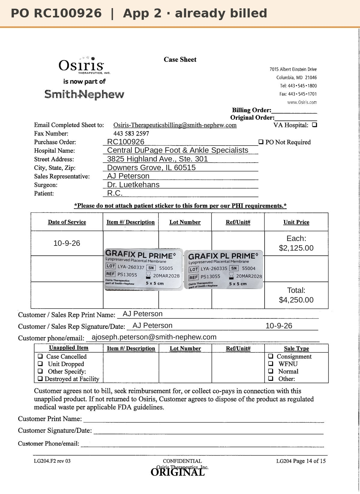

# Case sheet: R.C. 10/9/26 (5x5 ×2)

[⬅ Back to tracker](../README.md) · [PDF](./rc-1009.pdf) · [3x4 sheet](./rc-1009-3x4.md)

**Application #2** · record only: these two 5x5s were already billed on RC100926 (sale order, in SFDC 10/7). Don't submit again.

**Lot/SN**
```
LYA-260337_55005
```
```
LYA-260335_55004
```
**PO**
```
RC100926
```

| Field | Value |
| --- | --- |
| Date of service | 10/9/26 |
| Patient | R.C. |
| Account | Central DuPage Foot & Ankle Specialists (Downers Grove) |
| Surgeon | Dr. Luetkehans |
| Product | Grafix PL Prime 5x5 cm × 2 |
| REF | PS13055 |
| Units | LYA-260337_55005 (exp 3/20/28), LYA-260335_55004 (exp 3/20/28) |
| Price | $2,125.00 each, $4,250.00 for these two (RC100926 was 3 × 5x5, $6,375.00) |
| Status | In SFDC (RC100926). The 3rd 5x5 on this PO is at the clinic for 10/16 |
| Also used 10/9 | 3x4 LYA-250008_34006, billed separately: [3x4 sheet](./rc-1009-3x4.md) |


