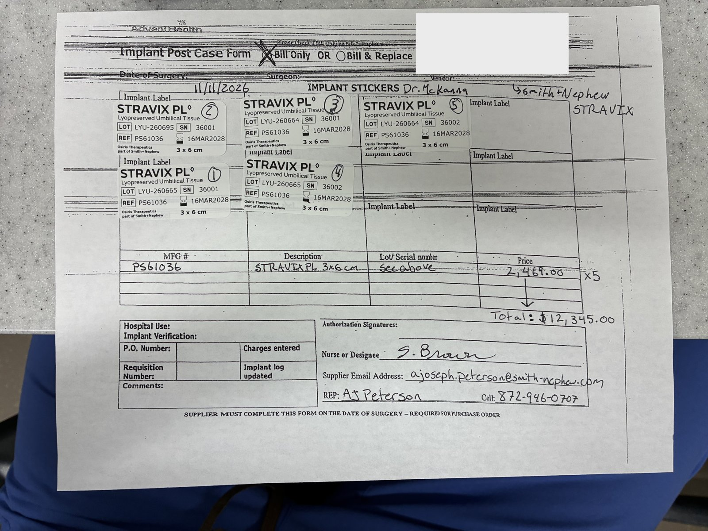

# Case sheet: R.N. 11/11/26

[⬅ Back to tracker](../README.md) · [PDF](./rn-1111.pdf)

**OR case** (not a recurring graft patient) · Bill Only

**Lot/SN**
```
LYU-260665_36001, LYU-260695_36001, LYU-260664_36001, LYU-260665_36002, LYU-260664_36002
```
**PO**
```
pending
```

| Field | Value |
| --- | --- |
| Date of service | 11/11/26 |
| Patient | R.N. |
| Account | UChicago Medicine AdventHealth GlenOaks (Acct #199254) |
| Surgeon | Dr. McKanna |
| Product | Stravix PL 3 x 6 cm (x5) |
| REF | PS61036 |
| Lots | LYU-260665, LYU-260695, LYU-260664 |
| Expiry | 3/16/28 |
| Price | Each: $2,469.00 · Total: $12,345.00 |
| Status | Waiting on the bill-only PO |
| Note | AJ's AdventHealth Implant Post Case Form photo from Chi West 11/11. Patient label covered on this copy |


