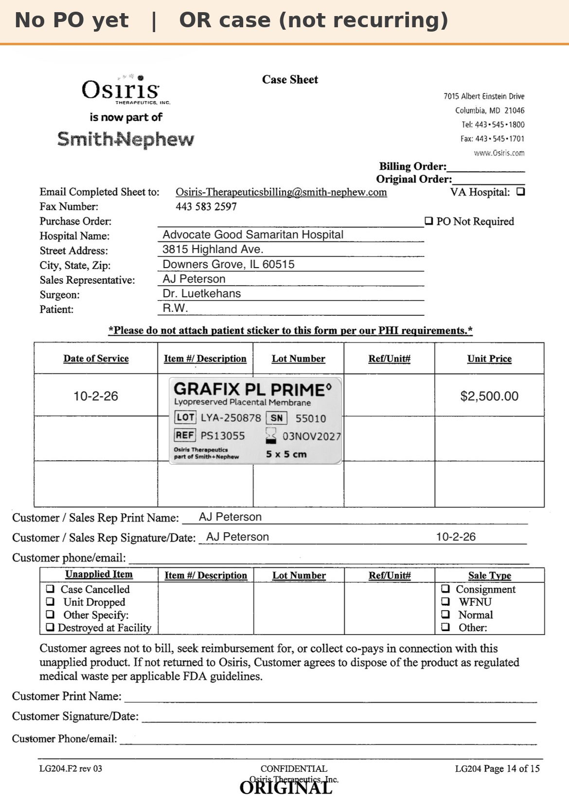

# Case sheet: R.W. 10/2/26

[⬅ Back to tracker](../README.md) · [PDF](./rw-1002.pdf)

**Lot/SN**
```
LYA-250878_55010
```
**PO**
```
PO005995283
```

| Field | Value |
| --- | --- |
| Date of service | 10/2/26 |
| Patient | R.W. |
| Account | Advocate Good Samaritan Hospital |
| Surgeon | Dr. Luetkehans |
| Product | Grafix PL Prime 5 x 5 |
| REF | PS13055 |
| Lot | LYA-250878 |
| SN | 55010 |
| Price | $2,500.00 |
| Expiry | 11/3/27 |
| Application |  |
| Status | Not submitted |
| Note | OR case at Good Sam (not a recurring graft patient). PO005995283 approved 10/5 (Owens & Minor), $2,500. Ready to submit |


