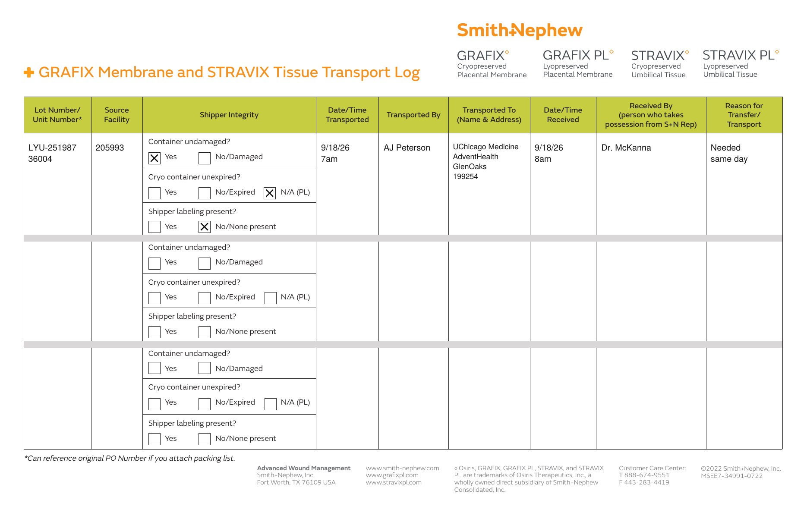

# Case sheet: S.A. 9/18/26

[⬅ Back to tracker](../README.md) · [Transfer log](./sa-0918-transport-log.pdf)

**OR case** · submitted in September

**Lot/SN**
```
LYU-251987_36004
```
**PO**
```
PO-1000841030
```

| Field | Value |
| --- | --- |
| Date of service | 9/18/26 |
| Patient | S.A. |
| Account | UChicago Medicine AdventHealth GlenOaks (OR) · 199254 |
| Surgeon | Dr. McKanna |
| Product | Stravix PL 3x6 cm |
| REF | PS61036 |
| Unit | LYU-251987_36004 (exp 8/18/27) |
| Price | $2,469.00 |
| Status | In SFDC (Bill Only PO-1000841030) |
| Note | Case sheet image not on file here (submitted in September) |


## Transfer log

Advocate South Suburban (205993) → GlenOaks (199254). The unit was still on Advocate South Suburban consignment in the BIOT Chicago district consignment report (10/11), so it was transferred to the account it was used at (needed same day, day used 7am to 8am).

[Transfer log PDF](./sa-0918-transport-log.pdf)


