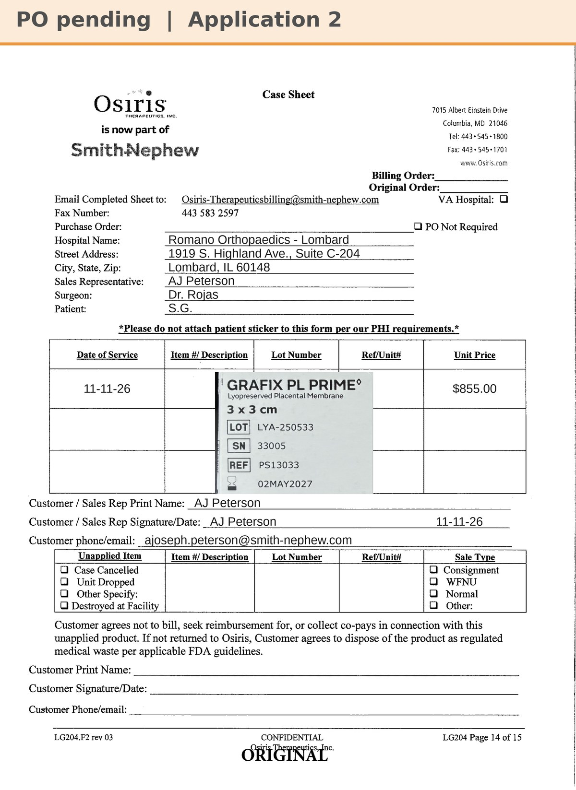
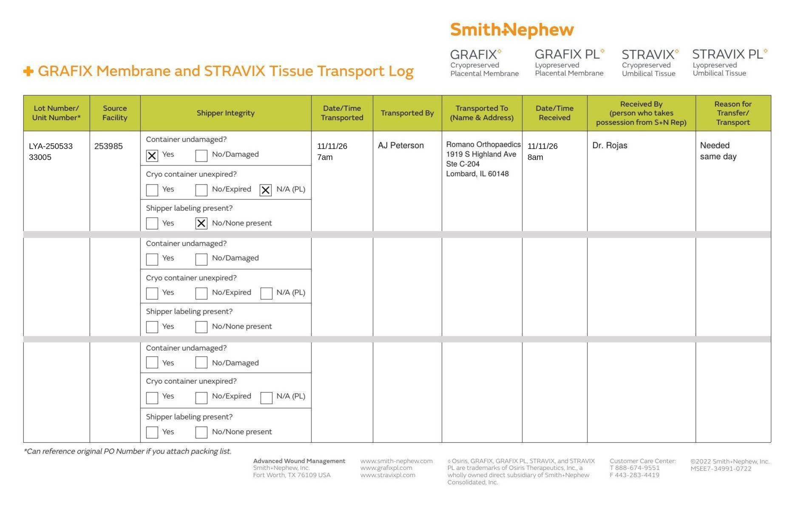

# Case sheet: S.G. 11/11/26

[⬅ Back to tracker](../README.md) · [PDF](./sg-1111.pdf) · [Transfer log](./sg-1111-transport-log.pdf)

**Application #2**

**Lot/SN**
```
LYA-250533_33005
```
**PO**
```
pending
```

| Field | Value |
| --- | --- |
| Date of service | 11/11/26 |
| Patient | S.G. |
| Account | Romano Orthopaedics - Lombard (1919 S. Highland Ave., Suite C-204, Lombard, IL 60148) |
| Surgeon | Dr. Rojas |
| Product | Grafix PL Prime 3x3 |
| REF | PS13033 |
| Lot | LYA-250533 |
| SN | 33005 |
| Price | $855.00 ($95/cm², 3x3 = 9 cm²) |
| Expiry | 5/2/27 |
| Application | #2 |
| Status | Waiting on the sale-order PO |
| Note | Case sheet made 11/11 from the sticker photo AJ uploaded in Chi West 11/11 |



## Transfer log

Alexian WCC shelf (253985) → Romano Orthopaedics, Lombard (acct # not on file). Per AJ's note on the box, this unit was a transfer from Alexian WCC, so it was moved to the account it was used at (needed same day, 11/11 7am to 8am, received by Dr. Rojas).

[Transfer log PDF](./sg-1111-transport-log.pdf)


