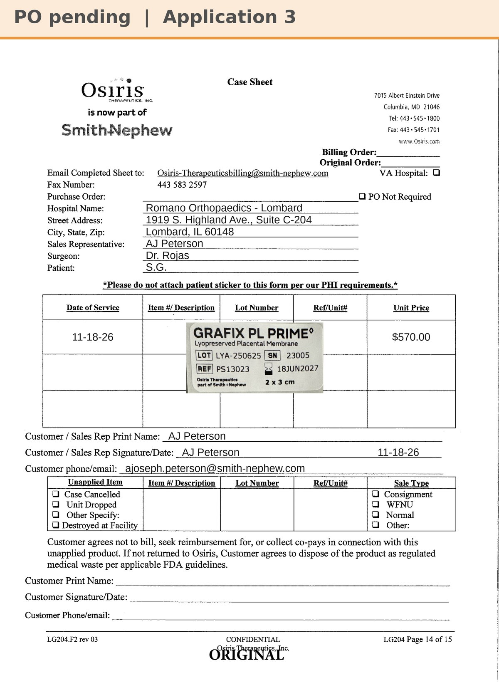

# Case sheet: S.G. 11/18/26

[⬅ Back to tracker](../README.md) · [PDF](./sg-1118.pdf)

**Application #3**

**Lot/SN**
```
LYA-250625_23005
```
**PO**
```
pending
```

| Field | Value |
| --- | --- |
| Date of service | 11/18/26 |
| Patient | S.G. |
| Account | Romano Orthopaedics - Lombard (1919 S. Highland Ave., Suite C-204, Lombard, IL 60148) |
| Surgeon | Dr. Rojas |
| Product | Grafix PL Prime 2x3 |
| REF | PS13023 |
| Lot | LYA-250625 |
| SN | 23005 |
| Price | $570.00 ($95/cm², 2x3 = 6 cm²) |
| Expiry | 6/18/27 |
| Application | #3 |
| Status | Waiting on the sale-order PO |
| Note | Made from AJ's sticker photo (Chi West 11/18). The Grafted tap said 3x3; the sticker is a 2x3, so the sheet follows the sticker until AJ says otherwise. Unit from the Alexian WCC shelf list (transfer to Romano) |


