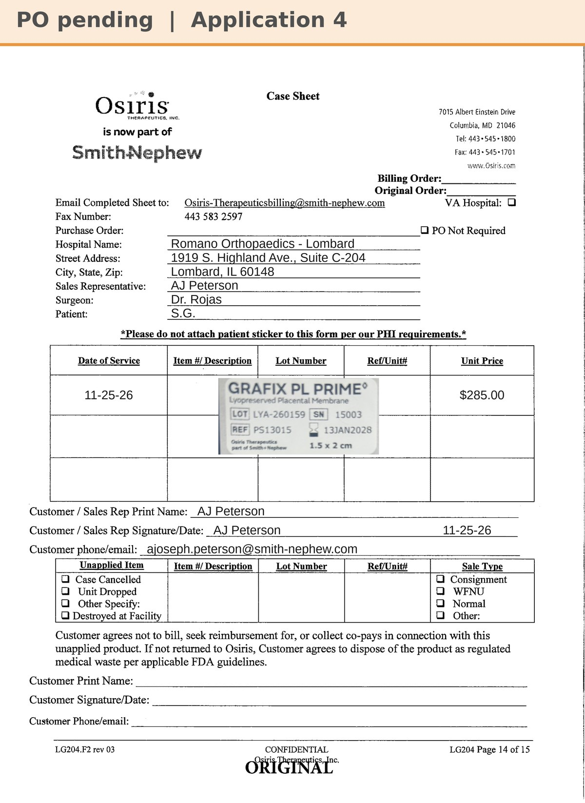

# Case sheet: S.G. 11/25/26

[⬅ Back to tracker](../README.md) · [PDF](./sg-1125.pdf)

**Application #4**

**Lot/SN**
```
LYA-260159_15003
```
**PO**
```
pending
```

| Field | Value |
| --- | --- |
| Date of service | 11/25/26 |
| Patient | S.G. |
| Account | Romano Orthopaedics - Lombard (1919 S. Highland Ave., Suite C-204, Lombard, IL 60148) |
| Surgeon | Dr. Rojas |
| Product | Grafix PL Prime 1.5x2 |
| REF | PS13015 |
| Lot | LYA-260159 |
| SN | 15003 |
| Price | $285.00 ($95/cm², 1.5x2 = 3 cm²) |
| Expiry | 1/13/28 |
| Application | #4 |
| Status | Waiting on the sale-order PO (Romano account not set up in SFDC yet) |
| Note | Made from AJ's sticker photo (Chi West 11/25). Unit from the Alexian WCC shelf list (transfer to Romano) |


