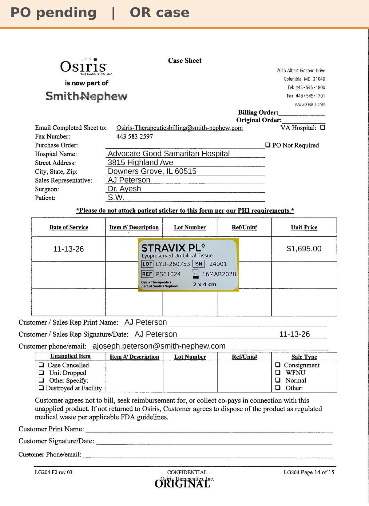

# Case sheet: S.W. 11/13/26

[⬅ Back to tracker](../README.md) · [PDF](./sw-1113.pdf)

**OR case** (not a recurring graft patient)

**Lot/SN**
```
LYU-260753_24001
```
**PO**
```
pending
```

| Field | Value |
| --- | --- |
| Date of service | 11/13/26 |
| Patient | S.W. |
| Account | Advocate Good Samaritan Hospital (OR, Acct #185725) |
| Surgeon | Dr. Ayesh |
| Product | Stravix PL 2 x 4 (PS61024) |
| Lot/SN | LYU-260753_24001 (exp 3/16/28) |
| Price | $1,695.00 (Good Sam 2x4 rate) |
| Status | Waiting on PO |
| Note | Case sheet made from the sticker AJ uploaded in Chi West 11/13 (the patient label is left off). Unit from the Good Sam OR shelf (one of the two incoming 2x4 restock units) |


