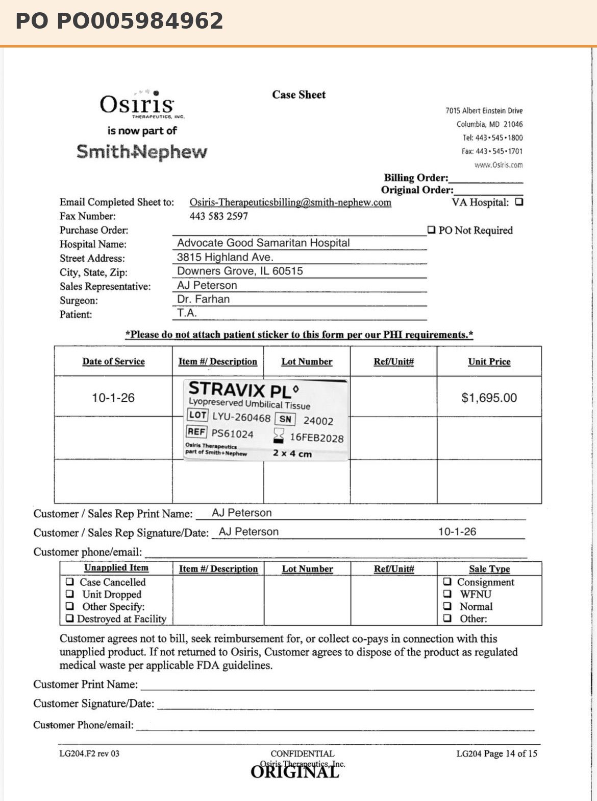

# Case sheet: T.A. 10/1/26

[⬅ Back to tracker](../README.md) · [PDF](./ta-1001.pdf)

**Lot/SN**
```
LYU-260468_24002
```
**PO**
```
none yet
```

| Field | Value |
| --- | --- |
| Date of service | 10/1/26 |
| Patient | T.A. |
| Account | Advocate Good Samaritan Hospital |
| Surgeon | Dr. Farhan |
| Product | Stravix PL 2 x 4 |
| REF | PS61024 |
| Lot | LYU-260468 |
| SN | 24002 |
| Price | $1,695.00 |
| Expiry | 2/16/28 |
| Status | Not submitted |
| Note | No PO yet |


