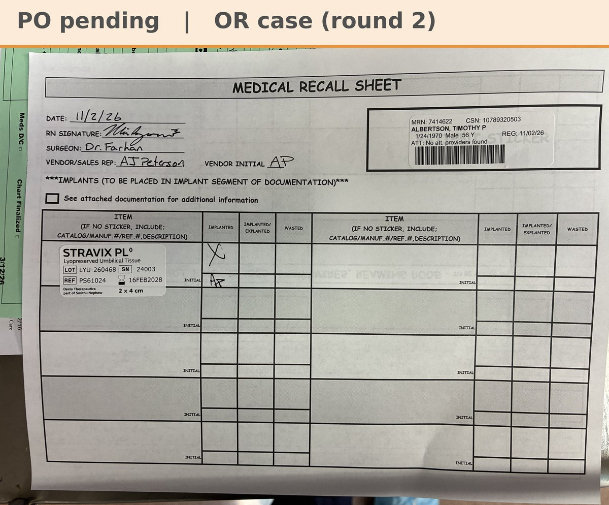

# Case sheet: T.A. 11/2/26

[⬅ Back to tracker](../README.md) · [PDF](./ta-1102.pdf)

**OR case, round 2** · T.A.'s second Stravix (separate case; round 1 was 10/1, [case sheet](./ta-1001.md))

**Lot/SN**
```
LYU-260468_24003
```
**PO**
```
pending
```

| Field | Value |
| --- | --- |
| Date of service | 11/2/26 (10:30 AM) |
| Patient | T.A. |
| Account | Advocate Good Samaritan Hospital (Acct #185725) |
| Surgeon | Dr. Farhan |
| Product | Stravix PL 2 x 4 |
| REF | PS61024 |
| Lot | LYU-260468 |
| SN | 24003 |
| Price | $1,695.00 |
| Expiry | 2/16/28 |
| Status | Waiting on the PO |
| Note | Good Sam medical recall sheet (implant record) uploaded in the Graft Tracker app 11/2. Unit from the Good Sam OR shelf (consigned). Good Sam PO (Owens & Minor) to come, like PO005984962 for round 1. The PO line and banner get updated when the PO arrives |


