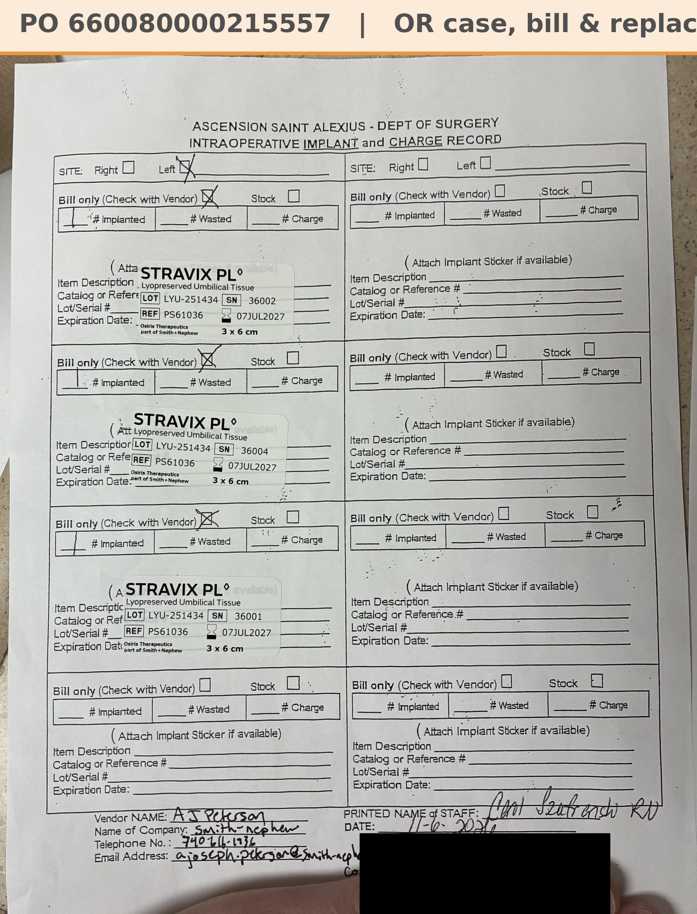

# Implant record: T.B. 11/6/26

[⬅ Back to tracker](../README.md) · [PDF](./tb-1106.pdf)

**OR case** (not a recurring graft patient) · St. Alexius OR shelf, bill & replace (AJ 11/12)

**Lot/SN**
```
LYU-251434_36002
```
```
LYU-251434_36004
```
```
LYU-251434_36001
```
**PO**
```
660080000215557
```

| Field | Value |
| --- | --- |
| Date of service | 11/6/26 |
| Patient | T.B. |
| Account | Ascension Saint Alexius (OR) |
| Surgeon | Dr. Singh |
| Site | Left |
| Product | Stravix PL 3x6 cm × 3 |
| REF | PS61036 |
| Units | LYU-251434_36002, LYU-251434_36004, LYU-251434_36001 (exp 7/7/27) |
| Price | $2,469.00 each, $7,407.00 total |
| Status | PO 660080000215557 (Ascension St. Alexius, dated 11/21): 3 x PS61036 Stravix 3x6 at $2,469.00 = $7,407.00, lot LYU-251434 serials 36002, 36004, 36001 (marked Consigned Item on the PO), matches the implant record. Bill & replace (AJ 11/12): posts to SFDC on its own, nothing to submit; the 3 Stravix 3x6 replacements are still to arrive on the shelf |


