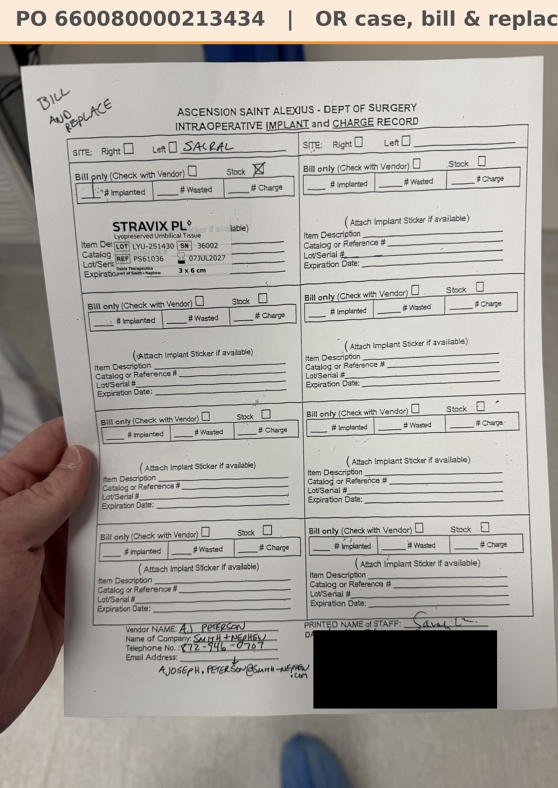

# Implant record: T.F. 10/16/26

[⬅ Back to tracker](../README.md) · [PDF](./tf-1016.pdf)

**OR case** (not a recurring graft patient) · St. Alexius bill & replace

**Lot/SN**
```
LYU-251430_36002
```
**PO**
```
660080000213434
```

| Field | Value |
| --- | --- |
| Date of service | 10/16/26 |
| Patient | T.F. |
| Account | Ascension Saint Alexius (OR) |
| Surgeon | Dr. Liao |
| Site | Sacral |
| Product | Stravix PL 3x6 cm |
| REF | PS61036 |
| Lot / SN | LYU-251430 / 36002 |
| Expiry | 7/7/27 |
| Price | $2,469.00 |
| Status | In SFDC on PO 660080000213434 |


