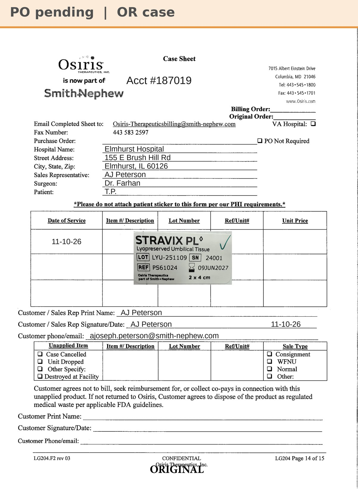

# Case sheet: T.P. 11/10/26

[⬅ Back to tracker](../README.md) · [PDF](./tp-1110.pdf)

**OR case** (not a recurring graft patient) · Bill Only

**Lot/SN**
```
LYU-251109_24001
```
**PO**
```
pending
```

| Field | Value |
| --- | --- |
| Date of service | 11/10/26 (morning) |
| Patient | T.P. |
| Account | Elmhurst Hospital (Acct #187019) |
| Surgeon | Dr. Farhan |
| Product | Stravix PL 2 x 4 |
| REF | PS61024 |
| Lot | LYU-251109 |
| SN | 24001 |
| Price | $1,988.66 on the tracker is an estimate (no Stravix 2x4 billed at Elmhurst yet); the PO's price replaces it |
| Expiry | 6/9/27 |
| Status | Needs PO (bill only; not in SFDC as a sale order) |
| Note | Case sheet made 11/10 from AJ's peel-off sticker photo (patient initials from AJ). From Elmhurst's own OR shelf (187019), so no transfer log |


