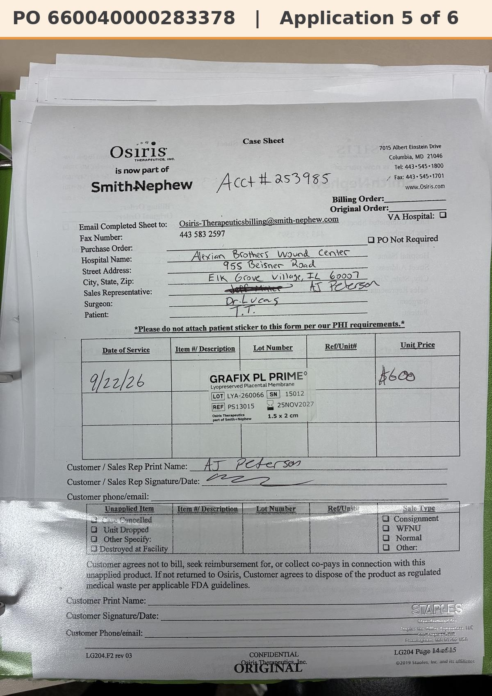

# Case sheet: T.T. 9/22/26

[⬅ Back to tracker](../README.md) · [PDF](./tt-0922.pdf)

**Application #4** of 5 to date (per the 10/2 patient list)

**Lot/SN**
```
LYA-260066_15012
```
**PO**
```
660040000283378
```
**Alexian ID**
```
0003008184
```

| Field | Value |
| --- | --- |
| Date of service | 9/22/26 |
| Patient | T.T. |
| Account | Alexian Brothers Wound Center |
| Surgeon | Dr. Lucas |
| Product | Grafix PL Prime 1.5 x 2 |
| REF | PS13015 |
| Lot | LYA-260066 |
| SN | 15012 |
| Price | $600.00 |
| Expiry | 11/25/27 |
| Application | #4 of 5 to date |
| Status | In SFDC |
| Note | App #4 of 5 (10/2 list). In SFDC: inv 0985784425 on PO ...283378 (billing corrected 9/30). Patient ID 0003008184, PS13015 1.5x2 $600 |


