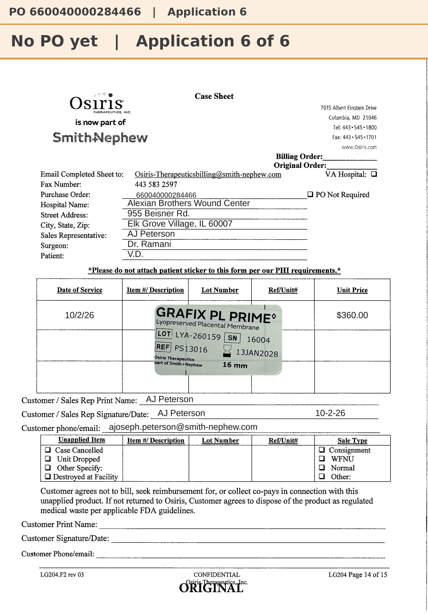

# Case sheet: V.D. 10/2/26

[⬅ Back to tracker](../README.md) · [PDF](./vd-1002.pdf)

**Application #6** of 6 to date (per the 10/2 patient list)

**Lot/SN**
```
LYA-260159_16004
```
**PO**
```
660040000284466
```
**Alexian ID**
```
0003043035
```

| Field | Value |
| --- | --- |
| Date of service | 10/2/26 |
| Patient | V.D. |
| Account | Alexian Brothers Wound Center |
| Surgeon | Dr. Ramani |
| Product | Grafix PL Prime 16mm disc |
| REF | PS13016 |
| Lot | LYA-260159 |
| SN | 16004 |
| Price | $360.00 |
| Expiry | 1/13/28 |
| Application | #6 of 6 to date |
| Status | Ready to submit (PO received 10/6) |
| Note | App #6. Case sheet corrected to 10/2/26 (regenerated from the template with the sticker photo). Down to 16mm (was 1.5x2). Waiting on the Alexian PO |


