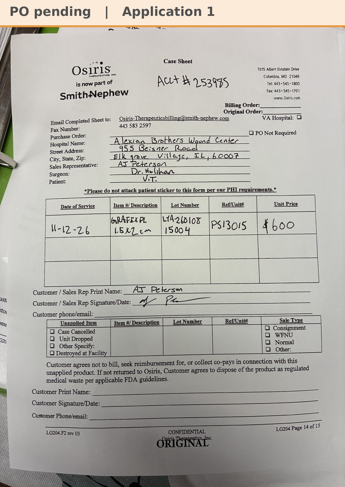

# Case sheet: V.T. 11/12/26

[⬅ Back to tracker](../README.md) · [PDF](./vt-1112.pdf)

**Application #1**

**Lot/SN**
```
LYA-260108_15004
```
**PO**
```
pending
```
**Alexian ID**
```
0003099658
```

| Field | Value |
| --- | --- |
| Date of service | 11/12/26 (1:50 PM) |
| Patient | V.T. |
| Account | Alexian Brothers Wound Center (Acct #253985) |
| Surgeon | Dr. Halihan |
| Product | Grafix PL Prime 1.5 x 2 |
| REF | PS13015 |
| Lot | LYA-260108 |
| SN | 15004 |
| Price | $600 |
| Expiry | 1/13/28 |
| Application | #1 |
| Status | Waiting on the bill-only PO |
| Note | AJ's case sheet photo from Chi West 11/12, with the Grafted tap. New start, from the Alexian WCC shelf. |


