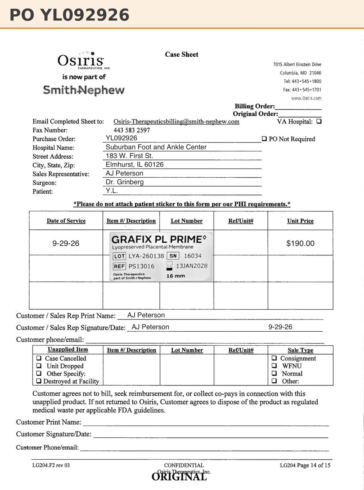
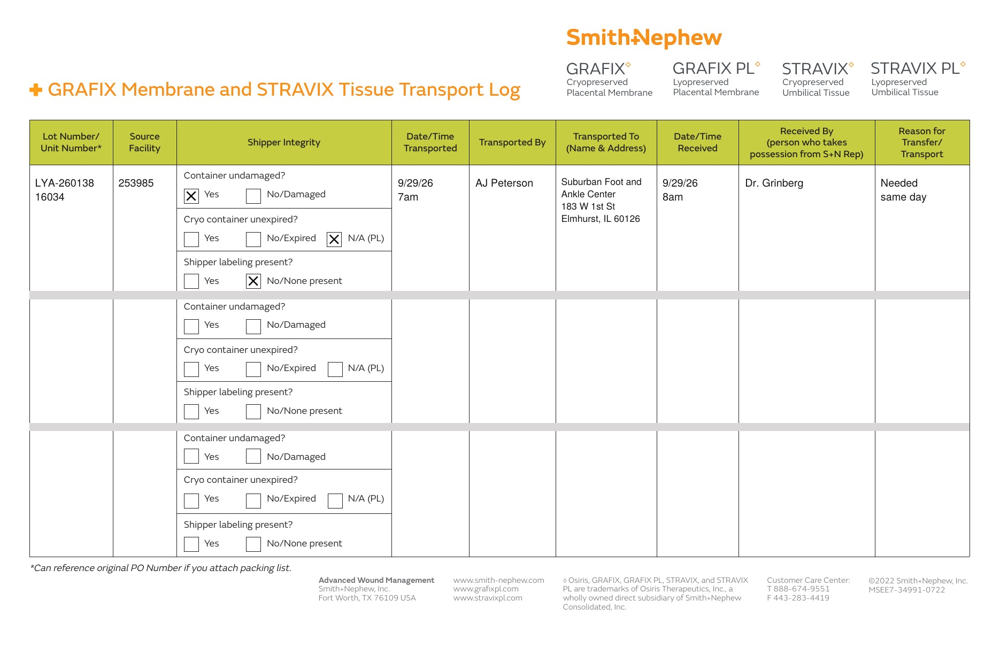

# Case sheet: Y.L. 9/29/26

[⬅ Back to tracker](../README.md) · [PDF](./yl-0929.pdf) · [Transfer log](./yl-0929-transport-log.pdf)

**Lot/SN**
```
LYA-260138_16034
```
**PO**
```
YL092926
```

| Field | Value |
| --- | --- |
| Date of service | 9/29/26 |
| Patient | Y.L. |
| Account | Suburban Foot and Ankle Center |
| Surgeon | Dr. Grinberg |
| Product | Grafix PL Prime 16mm disc |
| REF | PS13016 |
| Lot | LYA-260138 |
| SN | 16034 |
| Price | $190.00 |
| Expiry | 1/13/28 |
| Status | Not submitted |
| Note | PO on case sheet |



## Transfer log

Alexian WCC shelf (253985) → Suburban Foot and Ankle Center (Elmhurst office). Same lot as the three 16mm used at Alexian WCC the same day (T.T. LYA-260138_16031, M.L. _16032, A.N. _16033), so it came off the Alexian WCC shelf. It isn't on any account's consignment in the 10/11 district report, so the system can't confirm where it sits now. Transferred the day used (needed same day, 9/29 7am to 8am).

[Transfer log PDF](./yl-0929-transport-log.pdf)


